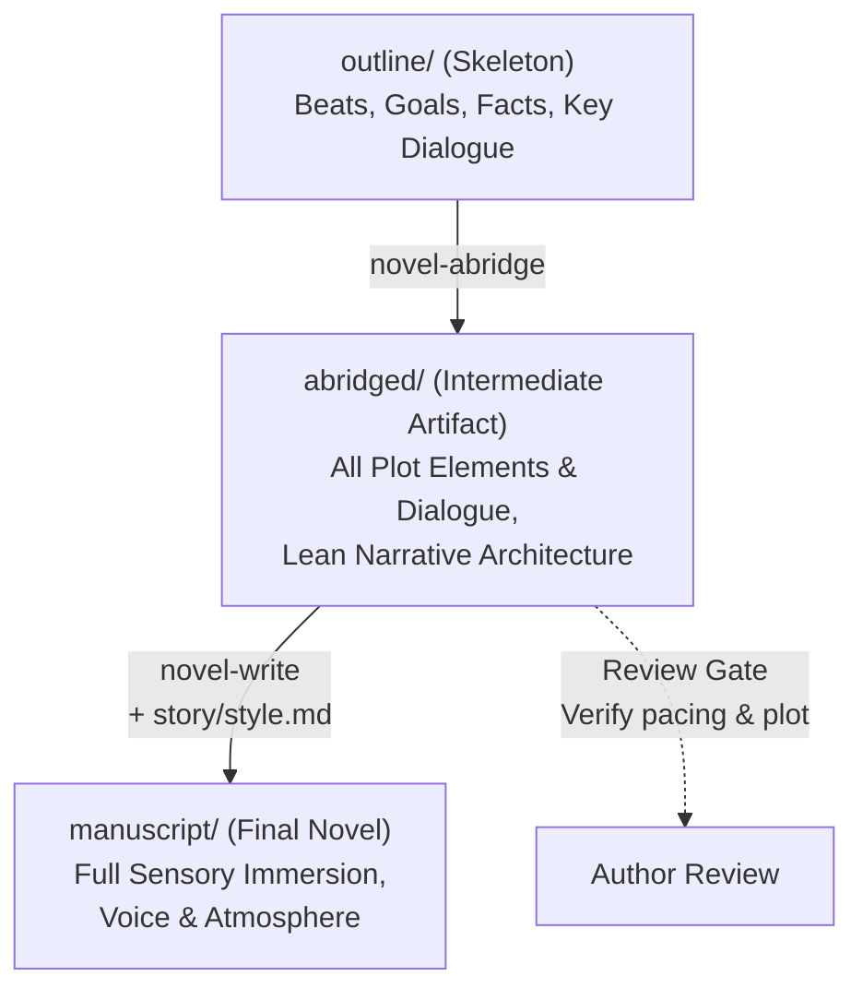

# Novel-Abridge

The **abridged draft** (`abridged/`) is the first complete readable version of the novel. It serves
as the intermediate bridge between the structural skeleton (`outline/`) and the fully rendered prose
(`manuscript/`).

The abridged draft's purpose is to lock down **event causation, scene momentum, emotional beats,
and key dialogue** without getting bogged down in atmospheric description, sensory flourishes,
or prose ornamentation.

* **Format and conventions**: [abridged-format.md](references/abridged-format.md)
* **Outline format**: [outline-format.md](../novel-outline/references/outline-format.md)
* **Helper**: `python <toolkit>/scripts/specnovel.py <command>`

---

## Role in the SpecNovelist Pipeline



- **All plot elements present**: Every beat in `outline/` must happen on the page. No plot leaps,
  no skipped sequences, no hand-waving transitions.
- **Important dialogue written in full**: All lines marked as `Key dialogue` in the scene outline
  and all substantive dialogue exchanges that carry conflict, subtext, character dynamics, or
  information revelation are written in complete, spoken lines.
- **Lean description**: Sensory descriptions, elaborate physical gestures, weather interludes,
  and atmospheric scene-setting are kept to their functional essentials.
- **Fast iteration**: Because the abridged draft is typically 30% to 50% of the target word count,
  the author can read, review, and adjust plot pacing, character agency, and dialogue subtext in
  hours rather than weeks.

---

## Workflow

### 1. Identify Scenes to Write or Update
Run:
```bash
python scripts/specnovel.py impact --stage abridged
```
Review the list of scenes. `impact` identifies:
- New scenes added to `outline/`.
- Scenes whose outline beats, goals, or key dialogues changed.
- Scenes whose referenced KB items (`CHR`, `PLC`, `FCT`, `WLD`, `PLT`) were modified.
- Deleted scenes that must be removed from `abridged/`.

### 2. Gather Scene Context
For each target scene (`SCN-xxx`):
1. **Outline contract**: Read the scene specification under `outline/`:
   - `When:` and `Where:`
   - `Cast:` and `POV:`
   - `Plot:` and `Goal / conflict / outcome:`
   - `Beats:` (the chronological sequence of actions)
   - `Key dialogue:` (binding lines)
   - `Change:` (the irreversible value shift at the scene's end)
2. **Knowledge-base context**:
   - `CHR`: Character voice, immediate motivations, relationship tensions, and what they currently
     know versus what they conceal.
   - `PLC`: Spatial layout required for blocking (doors, distances, obstacles).
   - `FCT` and `WLD`: Procedural or factual constraints governing the events.
3. **Editorial directives**:
   - Check `specnovel.py feedback SCN-xxx --stage abridged` (or inspect `story/editorial/`) for any
     open `EDT` directives affecting this scene or chapter, and apply them directly to the beats and dialogue.

### 3. Draft the Abridged Scene
Follow [abridged-format.md](references/abridged-format.md):
- Group scenes into chapter files matching the outline: `abridged/CHP-001.md`.
- Use the exact IDs in the markdown headings:
  ```markdown
  # CHP-001: The Letter

  ## SCN-001: Elena receives the letter
  ```
- **Action and Dialogue**: Render the scene sequentially beat-by-beat. Write every line of key
  dialogue verbatim. Write out supporting dialogue that establishes conflict and reveals character.
- **Lean Description**: Provide just enough stage direction and spatial cues so the reader follows
  physical action and emotional shifts.
- **Scene Change**: Ensure the scene finishes with the exact change specified in the outline.

### 4. Integrity and Pacing Check
Run:
```bash
python scripts/specnovel.py check
python scripts/specnovel.py stats
```
Verify that:
- Every scene belongs to its correct chapter and appears in strict outline order.
- No orphan scenes or dangling references exist.
- Word count ratio is healthy: abridged chapters typically represent 30%–50% of the target word count.

### 5. Author Review Gate
Present the abridged scenes to the author:
- Summarize how the dramatic beats played out and highlight key dialogue exchanges.
- Ask the author to review the abridged text for plot coherence, character voice, and pacing.
- If the author requests plot or character changes, update `outline/` or `kb/` first, then
  re-sync the abridged text.

Once approved, stage and commit the abridged baseline:
```bash
python scripts/specnovel.py accept --stage abridged -m "Abridge chapters 1-3"
```

---

## Rules

1. **Never omit an outline beat**: If a beat is specified in `outline/`, it must occur in `abridged/`.
2. **Never change the outcome**: The ending state and value shift of the scene must match the outline.
3. **Dialogue is not summary**: Do not replace dialogue with summaries like *"They argued about money."*
   Write the actual dialogue.
4. **Resist decorative prose**: Leave extended metaphors, deep introspection, atmospheric digressions,
   and lush world-building descriptions for the `novel-write` stage. Keep the abridged text lean.
5. **No novel-level IDs in prose**: Do not litter the abridged prose with raw `[[CHR-001]]` tags in
   the spoken text; use natural character names. (Markdown comments `<!-- note [[CHR-001]] -->` are
   permitted for internal notes).
