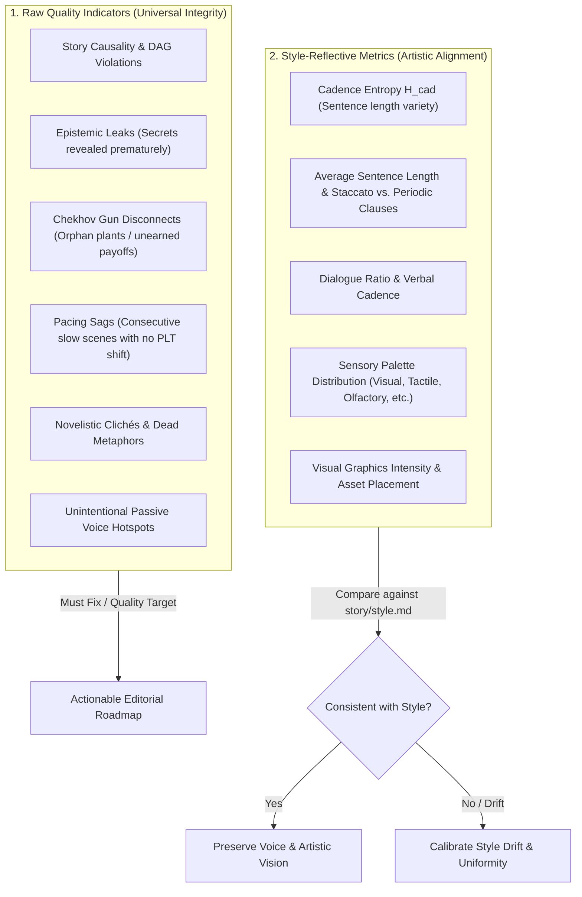
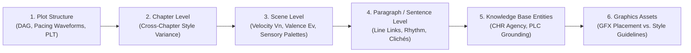

# Novel-Analyze

`novel-analyze` is the developmental editing, literary metrics, and stylistic telemetry engine of SpecNovelist.
It synthesizes computational metrics and editorial craft analysis into structured, actionable reports to guide
the author's creative revisions while maintaining full artistic control.

* **Analysis Guide**: [analysis-guide.md](references/analysis-guide.md)
* **Report Template**: [report-template.md](references/report-template.md)
* **Automated Telemetry CLI**: `python scripts/specnovel.py audit --report`

---

## Core Philosophy: Raw Quality vs. Style-Reflective Metrics

The analysis engine makes a fundamental distinction between two categories of metrics:



1. **Raw Quality Indicators**:
   - Universal narrative and technical integrity criteria that detract from immersion regardless of aesthetic goals.
   - Examples: plot holes, character acting on secrets they don't know, unresolved setups, pacing dead zones, dead idioms.
   - Evaluated against objective quality thresholds (e.g., zero leaked secrets, zero orphan plants, zero pacing sags).

2. **Style-Reflective Metrics**:
   - Technical values that reflect conscious artistic choices declared in `story/style.md`.
   - Examples: Hemingway-esque terse prose has low average sentence length (9–13 words) and moderate entropy; Faulknerian or Gothic prose has high average length (25–35 words) and high entropy ($H_{cad} \ge 2.5$).
   - Evaluated not against a generic standard, but against **fidelity to `story/style.md`** and **stylistic consistency throughout the novel**.

---

## Multi-Level Zoom-In Protocol

The analysis report zooms in systematically across all structural and textual levels of the project:



1. **Plot Structure Level (`outline/`, `PLT`, DAG)**:
   - Evaluates narrative momentum, causality chains, turning point distributions, and Chekhov gun setup/payoff distance gaps.
   - Highlights sequences of scenes where narrative velocity stalls ($V_n = 0$) across consecutive chapters.

2. **Chapter Level (`CHP-xxx`)**:
   - Audits **style consistency throughout the novel** by calculating cross-chapter variance:
     - Chapter sentence length variance ($\sigma_{sent}^2$).
     - Cadence entropy shifts ($H_{cad}$ dips).
     - Dialogue ratio shifts (e.g., Chapter 2 is 80% dialogue while Chapter 3 is 2% dialogue).
   - Detects accidental authorial fatigue or uncalibrated shifts in narrator distance.

3. **Scene Level (`SCN-xxx`)**:
   - Audits narrative velocity ($V_n$, plot changes per thousand words).
   - Tracks emotional valence trajectories ($E_v$, emotional rise and fall across scene beats).
   - Verifies scene cast agency, POV balance, and setting anchors.

4. **Paragraph & Sentence Level (`file://...#Lxx`)**:
   - Pinpoints exact file paths and line numbers for prose-level friction.
   - Identifies clusters of passive voice constructions.
   - Highlights novelistic clichés and suggests somatic or era-specific visceral alternatives.
   - Highlights monotone rhythm passages (strings of sentences with identical word counts).

5. **Knowledge Base Level (`kb/`)**:
   - Character agency and screen-time distribution (`CHR`): identifies neglected protagonists or over-indexed minor characters.
   - Setting grounding (`PLC`): flags scenes set in evocative locations that neglect the location's sensory palette (e.g., docklands lacking salt, bilge, and damp).
   - Researched fact integration (`FCT`): ensures historical or technical details are seamlessly woven into sensory action rather than dumped as exposition.

6. **Graphics Level (`graphics/`, `kb/graphics/`, `GFX-xxx`)**:
   - Audits graphics placeholders and references against `story/style.md` > `## Graphics Guidelines`.
   - Checks that asset intensity levels and visual triggers match the author's declared mandate.

---

## Step-by-Step Execution Workflow

### Step 1: Run Automated Telemetry
Generate the baseline computational telemetry report:
```bash
# Generate comprehensive markdown report with wiki-links
python scripts/specnovel.py audit --report --output reports/analysis.md

# For longitudinal tracking against last accepted baseline:
python scripts/specnovel.py audit --compare baseline

# For deep dive on a specific flagged scene:
python scripts/specnovel.py audit --scene SCN-014
```

### Step 2: Ingest & Audit `story/style.md`
Read `story/style.md` to extract the binding artistic parameters:
- **Voice & Rhythm**: Sentence structure, target cadence, punctuation rules.
- **POV & Interiority**: Tense, narrator distance, interior monologue conventions.
- **Dialogue Conventions**: Subtext density, tag vs. beat usage, vernacular.
- **Sensory Palette**: Key modalities emphasized for the setting and mood.
- **Graphics Guidelines**: Intensity level, artistic rendering styles, visual triggers.

### Step 3: Evaluate Style Compliance & Consistency
Compare observed metrics from the report against `story/style.md`:
1. **Sentence Rhythm**: Does average sentence length match the desired style? Is cadence entropy dynamic ($H_{cad} \ge 2.2$) or flat?
2. **Cross-Chapter Variance**: Does the prose drift between chapters? Flag chapters whose cadence entropy or dialogue ratio deviates significantly from the book's norm.
3. **Sensory Palette Grounding**: Are all five sensory modalities represented, or does the manuscript suffer from "floating head / white room" syndrome?
4. **Graphics Alignment**: Are graphics placed at the triggers defined in the style guide (e.g., spatial transitions, epistolary artifacts)?

### Step 4: Zoom In on Problematic & Interesting Areas
For every area flagged by the automated audit:
1. **Pacing Sags**: Trace the scene sequence in `outline/outline.md` and `abridged/`. Recommend introducing conflict, cutting exposition, or merging scenes.
2. **Chekhov Gaps**: Flag setups that have been dormant for $>10$ scenes without mention or paid off in the same scene without tension.
3. **Clichés & Passive Voice**: Provide clickable file links (`[file#Lxx](file:///...)`) and somatic alternatives that ground emotion in physical physiology.
4. **Epistemic Leaks**: Trace character knowledge in `outline/` to ensure no character acts on hidden information.

### Step 5: Format the Report with Wiki-Links
Ensure all project entities in the report are formatted with wiki-links:
- Scenes: `[[SCN-001]]`
- Chapters: `[[CHP-001]]`
- Characters: `[[CHR-001]]` or `[[CHR-001|Elena]]`
- Places: `[[PLC-001]]`
- Plot Elements: `[[PLT-001]]`
- Graphics: `[[GFX-001]]`
- Researched Facts: `[[FCT-001]]`
- Style Sections: `story/style.md`

### Step 6: Triage into Actionable Editorial Directives
Prioritize findings in the Actionable Editorial Roadmap:
1. **Tier 1 (High Priority / Causality & Logic)**: Fix epistemic leaks, DAG breaks, pacing sags, and broken Chekhov guns.
2. **Tier 2 (Medium Priority / Style & Sensory Polish)**: Ground under-textured scenes, replace clichés, and eliminate passive voice clusters.
3. **Tier 3 (Consistency & Polish)**: Smooth cross-chapter rhythm shifts and refine dialogue cadences.
If requested by the author, create editorial directives in `story/editorial/EDT-xxx.md` to lock in revision instructions across future sync cycles.
