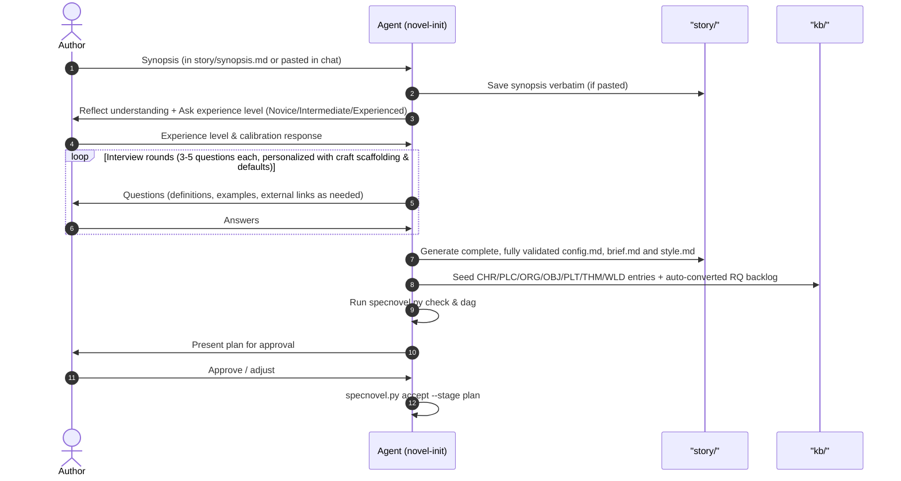

# Novel-Init

`novel-init` is the front door of the SpecNovelist process. It turns a raw synopsis into a
**seeded plan**: a brief, a style guide, a first knowledge base, and a research backlog, ready for
`novel-research` and `novel-outline`.

* **Interview guide**: [interview-guide.md](references/interview-guide.md)
* **Knowledge-base format**: [kb-format.md](../novel-author/references/kb-format.md)
* **Helper script**: `python <toolkit>/scripts/specnovel.py <command>` where `<toolkit>` is the
  SpecNovelist folder (e.g. `third_party/specnovelist`).

## Mode detection

1. Run `python <toolkit>/scripts/specnovel.py init`. It creates the git repo if needed and scaffolds
   `story/`, `kb/`, `outline/`, `abridged/`, `manuscript/` without overwriting existing files.
2. Decide the mode:
   - **Mode A: New novel.** `manuscript/` is empty. Follow the workflow below.
   - **Mode B: Existing draft.** The user already has chapters. Import them into `manuscript/`
     (one file per chapter), then reverse-engineer: draft the outline from the chapters (assign
     `CHP`/`SCN` IDs and add matching headings in the manuscript files), extract characters,
     places and facts into `kb/`, and produce the abridged layer from the manuscript. Flag every
     factual claim in the draft that needs a source as an `RQ` research question. Then continue
     at step 6 below.

## Workflow (Mode A)

### 1. Capture the seed
- If `story/synopsis.md` is still the template and the user pasted a synopsis in chat, save it
  **verbatim** into `story/synopsis.md` (set the `title:` front matter). Never embellish it.
- The synopsis is human-owned. From now on, decisions go into `story/brief.md` and `story/config.md`, not the synopsis.

### 2. Reflect & Calibrate Experience
- **Reflect understanding**: Summarize back in 5-10 bullets: premise, protagonist(s), setting(s) and era(s), central conflict,
  apparent ending, and the **setting type** of each setting (historical / contemporary / futuristic).
- **Calibrate author experience**: **Never assume the user is an expert novelist.** Ask the author upfront whether
  they consider themselves a **novice**, **intermediate**, or **experienced** novelist (or to describe their writing background).
- **Personalize the interview**:
  - *For Novices*: Provide gentle scaffolding, plain-English explanations, define domain terms in-flight (*psychic distance*, *head-hopping*, *free indirect discourse*, *inciting incident*, *dialogue tags vs action beats*), provide illustrative examples, and include external reference links (e.g. Wikipedia or standard craft guides) for questions requiring technical craft knowledge.
  - *For Intermediates*: Use standard craft terms with brief reminders and comparative genre touchstones.
  - *For Experienced*: Use concise technical dialogue, focusing on stylistic subtleties, anti-patterns, and publishing metadata.

### 3. Interview
Follow [interview-guide.md](references/interview-guide.md). Rules:
- **Agent-led**: you drive the agenda; the author answers. Batch 3-5 questions per round.
- **Always offer a recommended default** grounded in the synopsis and the genre, so the author can
  answer "go with your suggestions". Use the structured question tool (multiple choice + free
  text) when available.
- **Gather Project Configuration Data**: Collect Author Identity (name, email, legal name), target languages
  (primary and translations), front/back matter toggles (foreword, glossary, bibliography), and word budget.
- **Always Provide Decline / Skip Options for Optional Fields**: Distinguish clearly between required and
  optional inputs. For all optional metadata (legal name, contact info, subtitle, foreword, dedication, epigraph,
  historical notes, translation targets, secondary subplots, or custom voice samples), explicitly provide an
  option to decline or skip (e.g. *"Skip / Leave blank"*, *"Decide later"*, or *"None"*). If declined, populate
  clean empty/default values so `story/config.md` remains valid, and log deferred narrative items under
  `story/brief.md` > `## Open questions`.
- **Never research during the interview** beyond quick sanity checks; collect research needs as
  `RQ` items instead. Deep research is `novel-research`'s job.
- Stop interviewing when the brief and config have no blocking gaps; leave the rest in `## Open questions`.

### 4. Write `story/config.md`, `story/brief.md`, and `story/acknowledgements.md`
- **`story/config.md`**: Populate the complete Markdown project configuration specification: Author Identity,
  primary and target languages, front matter paths, back matter compilation toggles, budget targets, and locale
  typographical settings. Ensure zero missing required fields and strict schema compliance.
- **`story/brief.md`**: Fill every section of the template from the interview. Link to KB items with `[[ID]]` once they
  exist (step 5). Record undecided items under `## Open questions`; never resolve them silently.
- **`story/acknowledgements.md`**: Initialize the mandatory acknowledgements file. Ensure it includes transparent
  disclosure of all AI models assisting with the novel (seeded with the active assistant model, e.g. Gemini 2.5 Pro
  or Claude 3.7 Sonnet). Automated checks (`specnovel.py check`) enforce this disclosure.

### 5. Seed the knowledge base
Using the formats in [kb-format.md](../novel-author/references/kb-format.md):
- Create entries for every named character (`CHR`), significant place (`PLC`), organization
  (`ORG`), important object (`OBJ`), plot element (`PLT`: main plot, subplots, arcs, mysteries,
  secrets), theme (`THM`) and, for futuristic or invented elements, world rule (`WLD`).
- Real historical people and places get entries too; mark them `Historical: real` and attach `RQ`
  items for every claim about them that needs a source.
- Allocate every ID with `specnovel.py next-id <PREFIX>`, writing the file between calls so each
  call sees the previous ID. Never invent or reuse IDs by hand.
- **Automated Placeholder Conversion**: If `story/synopsis.md`, `story/brief.md`, or the initial seed
  entries contain placeholders (`[...]`, `<...>`, `TODO`), automatically run
  `python scripts/specnovel.py placeholders --create-rq` (or execute the equivalent automated extraction)
  to generate structured `RQ` entries in `kb/research/questions.md`. This automatically assigns sequential
  `RQ-xxx` IDs, priority, context excerpts, and entity links (`Needed for: [[ID]]`). Never ask the author
  to manually type research questions for provisional story placeholders.
- Create or update `kb/research/questions.md` with one `RQ` entry per research need, each with `Status:
  open`, a `Priority:` (high = blocks the outline) and `Needed for:` links.
- Do **not** create `FCT` entries from memory. Facts are only created by `novel-research`, with
  sources.

### 6. Style guide contract (`story/style.md`)
`story/style.md` is a required, binding input that must not remain a generic template:
- Craft an exhaustive, binding style guide of at least 400 words (typically 1,000–2,000 words) tailored to the genre,
  POV, tone, and author preferences established in the interview.
- Include mandatory sections:
  - Narrative stance, psychic distance, tense, and head-hopping bans.
  - Sentence rhythm, diction register, dialogue tag rules, and sensory priorities (the Friction Principle).
  - `# Locale: <locale>` section for each configured target language in `story/config.md` (defining punctuation, dialogue dashes/guillemets, and regional idioms).
  - `## Glossary Guidelines` (establishing criteria for terms cataloged under `kb/glossary/`).
  - `## Graphics Guidelines` (defining graphics intensity, artistic and technical rendering styles, trigger rules, placement, and localization).
  - Banned anti-patterns and clichés.
  - 2–3 exemplar voice anchors.

### 7. Automated Validation & Approval Gate
1. Run `python scripts/specnovel.py check` to verify:
   - `story/config.md` strictly validates against schema.
   - `story/acknowledgements.md` exists, is non-empty, and acknowledges all contributing AI models.
   - `story/style.md` has >= 400 words, contains all `# Locale: <locale>` sections, `## Glossary Guidelines`, and `## Graphics Guidelines`.
   - All seeded KB items have valid spatiotemporal metadata (`PLT`), valid types, and no dangling references.
2. Run `python scripts/specnovel.py index`.
3. Present a concise summary: brief highlights, config settings, catalog counts per type, research backlog (high
   priority first), open questions, and style anchors.
4. On approval: `python scripts/specnovel.py accept --stage plan --model <active-model> -m "Initialize novel plan"` (establishes initial
   baselines for `brief`, `research`, `bible`, and `outline`, recording the `Novel-Model:` git trailer).
5. Conclude execution cleanly once the plan is initialized and validated. Do not prompt, ask, or suggest to the author to advance to subsequent pipeline stages (progression is strictly user-driven in the UI).

> [!NOTE]
> **Decoupled Brief Updates**: `novel-init` is exclusively used for Day 1 onboarding. When the author
> modifies `story/synopsis.md` or `story/brief.md` later in the project, deltas are isolated using
> `specnovel.py delta --stage brief` and propagated via `novel-sync`, without re-running `novel-init`.

## Rules
- Always provide a clear way for the user to decline entering information that is optional (never force optional metadata or stall on unsupplied details).
- Never edit `story/synopsis.md` or `story/style.md` without the author's explicit approval.
- Never fabricate researched facts or sources; route every factual need to an `RQ` item.
- Keep KB entries short at this stage; they grow during research and outlining.
