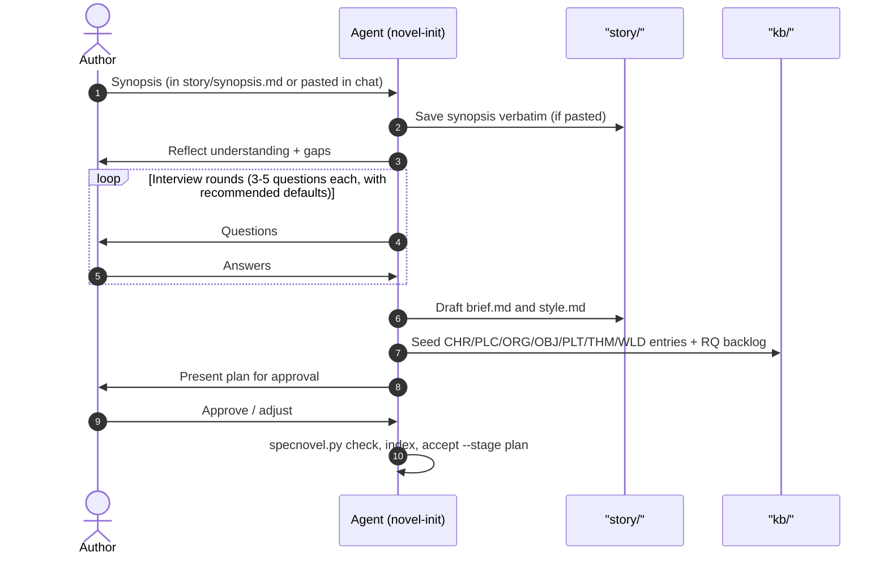

# Novel-Init

`novel-init` is the front door of the SpecNovelist process. It turns a raw synopsis into a
**seeded plan**: a brief, a style guide, a first knowledge base, and a research backlog, ready for
`novel-research` and `novel-outline`.

* **Interview guide**: [interview-guide.md](references/interview-guide.md)
* **Knowledge-base format**: [kb-format.md](../novel-author/references/kb-format.md)
* **Helper script**: `python <toolkit>/scripts/specnovel.py <command>` where `<toolkit>` is the
  SpecNovelist folder (e.g. `third_party/specnovelist`).

## Mode detection

1. Run `python <toolkit>/scripts/specnovel.py init`. It creates the git repo if needed and scaffolds
   `story/`, `kb/`, `outline/`, `abridged/`, `manuscript/` without overwriting existing files.
2. Decide the mode:
   - **Mode A: New novel.** `manuscript/` is empty. Follow the workflow below.
   - **Mode B: Existing draft.** The user already has chapters. Import them into `manuscript/`
     (one file per chapter), then reverse-engineer: draft the outline from the chapters (assign
     `CHP`/`SCN` IDs and add matching headings in the manuscript files), extract characters,
     places and facts into `kb/`, and produce the abridged layer from the manuscript. Flag every
     factual claim in the draft that needs a source as an `RQ` research question. Then continue
     at step 6 below.

## Workflow (Mode A)

### 1. Capture the seed
- If `story/synopsis.md` is still the template and the user pasted a synopsis in chat, save it
  **verbatim** into `story/synopsis.md` (set the `title:` front matter). Never embellish it.
- The synopsis is human-owned. From now on, decisions go into `story/brief.md`, not the synopsis.

### 2. Reflect
Summarize back in 5-10 bullets: premise, protagonist(s), setting(s) and era(s), central conflict,
apparent ending, and the **setting type** of each setting (historical / contemporary / futuristic).
List what is missing or ambiguous. Propose a provisional list of characters, places, plot threads
and research topics the synopsis implies.

### 3. Interview
Follow [interview-guide.md](references/interview-guide.md). Rules:
- **Agent-led**: you drive the agenda; the author answers. Batch 3-5 questions per round.
- **Always offer a recommended default** grounded in the synopsis and the genre, so the author can
  answer "go with your suggestions". Use the structured question tool (multiple choice + free
  text) when available.
- **Never research during the interview** beyond quick sanity checks; collect research needs as
  `RQ` items instead. Deep research is `novel-research`'s job.
- Stop interviewing when the brief has no blocking gaps; leave the rest in `## Open questions`.

### 4. Write `story/brief.md`
Fill every section of the template from the interview. Link to KB items with `[[ID]]` once they
exist (step 5). Record undecided items under `## Open questions`; never resolve them silently.

### 5. Seed the knowledge base
Using the formats in [kb-format.md](../novel-author/references/kb-format.md):
- Create entries for every named character (`CHR`), significant place (`PLC`), organization
  (`ORG`), important object (`OBJ`), plot element (`PLT`: main plot, subplots, arcs, mysteries,
  secrets), theme (`THM`) and, for futuristic or invented elements, world rule (`WLD`).
- Real historical people and places get entries too; mark them `Historical: real` and attach `RQ`
  items for every claim about them that needs a source.
- Allocate every ID with `specnovel.py next-id <PREFIX>`, writing the file between calls so each
  call sees the previous ID. Never invent or reuse IDs by hand.
- **Automated Placeholder Conversion**: If `story/synopsis.md`, `story/brief.md`, or the initial seed
  entries contain placeholders (`[...]`, `<...>`, `TODO`), automatically run
  `python scripts/specnovel.py placeholders --create-rq` (or execute the equivalent automated extraction)
  to generate structured `RQ` entries in `kb/research/questions.md`. This automatically assigns sequential
  `RQ-xxx` IDs, priority, context excerpts, and entity links (`Needed for: [[ID]]`). Never ask the author
  to manually type research questions for provisional story placeholders.
- Create or update `kb/research/questions.md` with one `RQ` entry per research need, each with `Status:
  open`, a `Priority:` (high = blocks the outline) and `Needed for:` links.
- Do **not** create `FCT` entries from memory. Facts are only created by `novel-research`, with
  sources.

### 6. Style guide
`story/style.md` is a required, binding input. If it is still the template:
- Ask whether the author wants to write it, have you draft it from the interview's voice answers,
  or derive it from sample passages they admire (analyze POV, tense, sentence rhythm, diction,
  dialogue conventions, figurative language, and record them as concrete rules with examples).
- A draft from you must be **approved by the author**. It may be completed later, but
  `novel-write` refuses to run while `check` warns that it is too thin.

### 7. Approval gate and baseline
1. Run `specnovel.py check` and fix all errors; run `specnovel.py index`.
2. Present a concise summary: brief highlights, catalog counts per type, research backlog (high
   priority first), open questions, and any style-guide gaps.
3. On approval: `specnovel.py accept --stage plan -m "Initialize novel plan"` (establishes initial
   baselines for `brief`, `research`, `bible`, and `outline`).
4. Recommend the next step: `novel-research` for high-priority `RQ` items, then `novel-outline`.

> [!NOTE]
> **Decoupled Brief Updates**: `novel-init` is exclusively used for Day 1 onboarding. When the author
> modifies `story/synopsis.md` or `story/brief.md` later in the project, deltas are isolated using
> `specnovel.py delta --stage brief` and propagated via `novel-sync`, without re-running `novel-init`.

## Rules
- Never edit `story/synopsis.md` or `story/style.md` without the author's explicit approval.
- Never fabricate researched facts or sources; route every factual need to an `RQ` item.
- Keep KB entries short at this stage; they grow during research and outlining.
