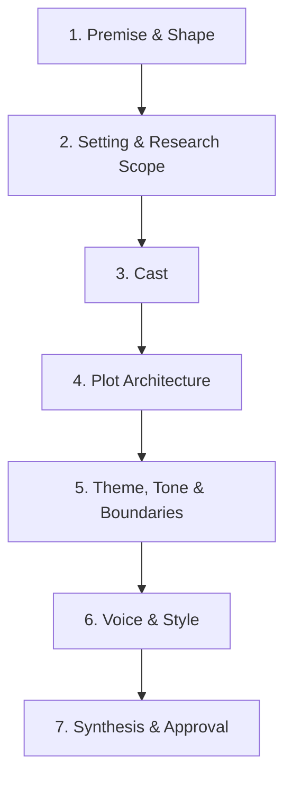

# Novel Discovery Interview Guide

Used by `novel-init` to turn a seed synopsis into a brief, a style guide and a seeded knowledge
base. The agent leads; the author decides.

## Principles
- **Batch** 3-5 questions per round; never dump the whole questionnaire at once.
- **Recommend a default** for every question, derived from the synopsis, the genre's reader
  expectations, and what makes the story strongest. Say why in one clause.
- **Skip what the synopsis already answers**; confirm it in the reflection instead.
- **Prefer choices to blank prompts** ("Close third, past tense, single POV (recommended) / rotating
  close third / first person") while always allowing free-text answers.
- **Record as you go**: after each round, tell the author which file/section each answer lands in.
- **Defer research**: when an answer depends on facts ("Could a woman be a ship's surgeon in
  1912?"), log an `RQ` item with priority, and continue with a provisional assumption.

## Phases

### Phase 1: Premise and shape
1. Logline: *who* wants *what*, *against what opposition*, *with what at stake*? (Offer a draft.)
2. Genre/subgenre, audience, and 2-4 comparable titles.
3. Target length (recommend by genre: e.g. literary 80-100k, thriller 90-100k, epic fantasy/SF
   100-150k) and an approximate chapter count/length.
4. Working title.

### Phase 2: Setting and research scope
1. For each setting: place, era/date range, and **type** - historical, contemporary (fix an "as of"
   date), or futuristic (how far ahead; extrapolated from which present-day trends?).
2. Research rigor: strict accuracy, accurate-with-documented-liberties (recommended for most
   historical fiction, with an author's note), or loose/atmospheric.
3. Real people and real events that appear on the page, and how they may be portrayed.
4. Known research needs (technology, medicine, law, language, daily life, politics, science).
   Each becomes an `RQ` item with a priority.
5. Futuristic only: which speculative premises are allowed to break current knowledge (these
   become `WLD` rules with `Basis: invented`) versus which must stay plausible (`Basis: [[FCT-...]]`).

### Phase 3: Cast
1. Protagonist(s): external goal, internal need, flaw/wound, arc (from -> to).
2. Antagonist/opposition: what they want and why they believe they are right.
3. Supporting cast: role in the plot and relationship to the protagonist.
4. POV characters and why each one earns a POV.
5. Names: period/culture-appropriate naming (log an `RQ` if unsure).

### Phase 4: Plot architecture
1. Structural model (three-act / four-act / seven-point / hero's journey / mystery structure /
   braided timelines / kishotenketsu). Recommend one that fits the genre and synopsis.
2. Inciting incident, midpoint reversal, dark moment, climax, resolution - draft them from the
   synopsis and ask the author to confirm or change.
3. Subplots and how they braid with the main plot; mysteries/secrets and when they are revealed.
4. The ending, precisely, including what each main character has gained or lost.
5. Timeline: linear, flashbacks, dual timeline, frame story?

### Phase 5: Theme, tone and boundaries
1. The question the novel explores; recurring motifs/symbols.
2. Tone (and how it shifts across the book).
3. Content boundaries: violence, sex, language, depiction of historical prejudice, sensitivity
   considerations.

### Phase 6: Voice and style (feeds `story/style.md`)
1. POV person, distance, tense; head-hopping policy.
2. Prose register: spare / balanced / lush; sentence rhythm; description density.
3. Dialogue conventions: tags, dialect rendering, period speech, profanity.
4. Exposition policy for researched material (filtered through the POV, no info dumps).
5. Mechanics: US/UK spelling, quotation style, em dashes, numbers.
6. Touchstone authors and what to borrow from each; anti-patterns to ban.
7. Optional: ask for 1-3 sample passages to use as voice anchors, and analyze them.

### Phase 7: Synthesis and approval
1. Write `story/brief.md`, draft `story/style.md` (if requested), seed `kb/` and the `RQ` backlog.
2. Present the summary and the open questions; get approval; accept the `plan` baseline.

## Output mapping

| Answer | Lands in |
|---|---|
| Logline, genre, length, POV/tense summary, setting overview, rigor, ending | `story/brief.md` |
| Detailed voice and mechanics rules, anti-patterns, voice anchors | `story/style.md` |
| Each character, place, org, object | `kb/characters/`, `kb/places/`, `kb/organizations/`, `kb/objects/` |
| Plot threads, arcs, mysteries, secrets | `kb/plot/` (`PLT`) |
| Themes and motifs | `kb/themes/` (`THM`) |
| Speculative premises and invented rules | `kb/world/` (`WLD`) |
| Known dated events (historical or story) | `kb/timeline/` (`TML`) |
| Anything that needs a source | `kb/research/questions.md` (`RQ`) |
| Undecided items | `story/brief.md` > `## Open questions` |
