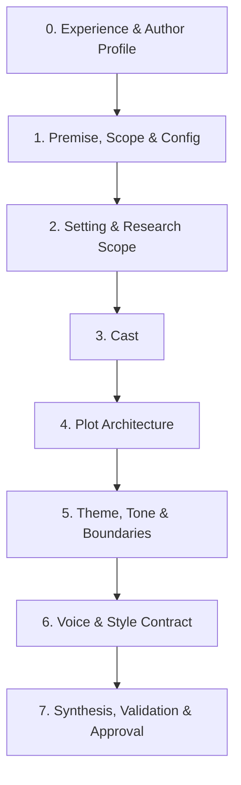

# Novel Discovery Interview Guide

Used by `novel-init` to turn a seed synopsis into a brief, a style guide, a complete project
configuration specification, and a seeded knowledge base. The agent leads; the author decides.

## Principles

- **Never Assume Expert Status**: Writers range from first-time novices to seasoned pros. Always
  gauge the author's background upfront and personalize the interview's depth, tone, and scaffolding.
- **Batch** 3-5 questions per round; never dump the whole questionnaire at once.
- **Recommend a default** for every question, derived from the synopsis, the genre's reader
  expectations, and what makes the story strongest. Say why in one clause.
- **Skip what the synopsis already answers**; confirm it in the reflection instead.
- **Prefer choices to blank prompts** ("Close third, past tense, single POV (recommended) / rotating
  close third / first person") while always allowing free-text answers.
- **Record as you go**: after each round, tell the author which file/section each answer lands in.
- **Defer research**: when an answer depends on facts ("Could a woman be a ship's surgeon in
  1912?"), log an `RQ` item with priority, and continue with a provisional assumption.
- **Always Provide Decline / Skip Options for Optional Information**:
  - Distinguish clearly between **[Required]** items (e.g. logline, core protagonist, primary language, working title) and **[Optional]** items (e.g. legal name, author email/URL, subtitle, foreword, epigraph, dedication, historical note, secondary subplots, translation targets, or sample excerpts).
  - Every question concerning optional fields or secondary creative decisions must explicitly offer an option to decline, skip, or defer (e.g. `"Skip / Leave blank"`, `"Decide later"`, or `"None"`).
  - Never pressure or force the author to supply optional metadata; if declined, the agent applies clean empty/default values so `story/config.md` and `story/brief.md` remain valid and clean.
  - If narrative items are deferred (e.g. subplots or minor characters), log them under `## Open questions` in `story/brief.md` rather than stalling the interview.
- **Produce Complete, Fully Valid Artifacts**: The onboarding interview must never leave `story/config.md`
  or `story/style.md` as empty or generic placeholders. When the interview finishes, both files must
  contain rich, pertinent information that passes `specnovel.py check` with zero errors or warnings.

---

## Experience Level Adaptation Matrix

During Phase 0, the agent asks the author to classify their experience level. The agent must
calibrate its communication style throughout all remaining phases:

| Author Level | Agent Tone & Approach | Craft Scaffolding & Hyperlinks | Defaults & Examples |
|---|---|---|---|
| **Novice** *(First novel, beginner, or hobbyist)* | Encouraging, patient, structured, educational. Demystifies the writing process without being condescending. | **Define domain terms in-flight** (e.g. *psychic distance*, *head-hopping*, *free indirect discourse*, *three-act structure*, *inciting incident*, *dialogue tags vs action beats*). Provide **external reference hyperlinks** to trusted craft definitions (e.g. [Three-Act Structure](https://en.wikipedia.org/wiki/Three-act_structure), [Free Indirect Discourse](https://en.wikipedia.org/wiki/Free_indirect_speech), [Show, Don't Tell](https://en.wikipedia.org/wiki/Show,_don%27t_tell)). | Provide **concrete before-and-after examples** illustrating choices. Offer strong recommended defaults and explain the narrative benefits in plain English. |
| **Intermediate** *(Written short stories, drafts, familiar with basics)* | Collaborative, focused, genre-aware. Treats the author as a fellow storyteller. | Standard literary terminology with brief context reminders. Compare choices to well-known books or films in the chosen genre. | Offer genre-tuned defaults with options to customize character arcs, subplot braids, and pacing cadences. |
| **Experienced / Professional** *(Published author, seasoned novelist)* | Efficient, technical, peer-to-peer. Fast-paced and direct. | High-level technical shorthand (*tight third*, *midpoint reversal*, *distancing filters*). Focus on subtle craft constraints, anti-pattern bans, and distinct voice anchors. | Concise options. Moves quickly through structural questions to spend time on bespoke voice, translation targets, and publication metadata. |

---

## Phases

### Phase 0: Experience Calibration & Author Identity
1. **Experience level** [Required]:
   - Ask the user: *"Are you a novice novelist (writing your first book or new to storytelling mechanics), an intermediate writer (familiar with story structures and drafts), or an experienced/published author? Or feel free to describe your writing background."*
   - Set the agent's scaffolding level according to the matrix above.
2. **Author Identity** (populates `story/config.md`):
   - **Author name** [Required]: Pen name or public attribution.
   - **Legal name** [Optional]: For copyright/legal records if different. **Provide explicit option: `"Skip / Same as author name"`**.
   - **Contact email & URL** [Optional]: **Provide explicit option: `"Skip / Leave blank"`**.
3. **Language & Translations** (populates `story/config.md`):
   - **Primary language/locale** [Required]: (e.g. `en-US`, `en-GB`, `fr-FR`).
   - **Planned translation targets** [Optional]: **Provide explicit option: `"Primary language only / No translations for now"`**.

### Phase 1: Premise, Scope & Publication Budget
1. **Logline** [Required]: *Who* wants *what*, *against what opposition*, *with what at stake*? (Offer a drafted logline based on synopsis).
   - *For Novices*: Explain what a logline is and provide an example from a classic like *The Hunger Games* or *The Godfather*.
2. **Genre & Comps**:
   - **Genre/subgenre & audience** [Required]: Core genre and readership (Adult, YA, etc.).
   - **Comparable titles (Comps)** [Optional]: **Provide explicit option: `"Skip comps / None"`**.
3. **Word Budget & Scope** (feeds `story/config.md` and `story/brief.md`):
   - **Target word count** [Required]: (Recommend by genre: e.g. Mystery/Thriller 80-90k, Literary 80-100k, Epic Sci-Fi/Fantasy 100-140k).
   - **Tolerance percentage & chapter targets** [Optional]: (Offer standard default: 10% tolerance, 3,000-word scenes; **provide option: `"Use recommended defaults"`**).
4. **Working Title & Subtitle**:
   - **Working Title** [Required]: (Feeds `story/config.md` and `story/brief.md`).
   - **Subtitle** [Optional]: **Provide explicit option: `"No subtitle / Skip"`**.

### Phase 2: Setting, Research Scope & Back Matter
1. **Settings** [Required]: For each setting, define location, era/date range, and **type**:
   - *Historical*: Specify period constraints.
   - *Contemporary*: Fix an "as of" date (e.g. Autumn 2024).
   - *Futuristic*: Extrapolate from specific present-day trends.
2. **Research Rigor** [Required]:
   - Strict accuracy, accurate-with-documented-liberties (recommended for historical fiction), or loose/atmospheric.
3. **Front & Back Matter Decisions** (feeds `story/config.md`):
   - **Foreword / Preface** [Optional]: Does the novel have an introductory foreword or preface? **Provide explicit option: `"No foreword / Skip"`**.
   - **Historical Note / Afterword** [Optional]: Appendix explaining factual liberties or historical context? **Provide explicit option: `"No historical note / Decide later"`**.
   - **Glossary & Bibliography toggles** [Optional]: (Offer recommended default: `true`; **provide option: `"Disable glossary/bibliography"`**).
   - **Dedication / Epigraph** [Optional]: **Provide explicit option: `"Skip / Leave blank"`**.
4. **Known Research Needs** [Optional / Open Backlog]:
   - Technological, medical, legal, linguistic, or historical topics to research (seeded into `kb/research/questions.md`; **provide option: `"None known yet; convert provisional placeholders during research"`**).

### Phase 3: Cast
1. **Protagonist(s)** [Required]: External goal (what they want), internal need (what they lack), emotional flaw/wound, and arc trajectory (from -> to).
   - *For Novices*: Explain the difference between an external goal ("solve the murder") and an internal need ("learn to trust again").
2. **Antagonist / Opposing Force** [Required]: What they want and why they believe their cause is just.
3. **Supporting Cast** [Optional / Incremental]: Key secondary characters, their narrative function, and relationship to protagonist. **Provide explicit option: `"Focus on protagonist and antagonist for now; add supporting cast in outline stage"`**.
4. **POV Allocation** [Required]: Viewpoint characters and why each earns a distinct POV.
5. **Names & Naming Conventions** [Optional / Deferrable]: Period- and culture-appropriate naming. If author hasn't chosen, **provide option: `"Use provisional functional placeholders (e.g. '[Protagonist]', '[Harbor Master]') to research names later"`**.

### Phase 4: Plot Architecture
1. **Structural Model** [Required]:
   - Recommend a model suited to the genre (e.g. [Three-Act Structure](https://en.wikipedia.org/wiki/Three-act_structure), [Four-Act / Midpoint Mirror](https://en.wikipedia.org/wiki/Dramatic_structure), [Seven-Point Story Structure](https://en.wikipedia.org/wiki/Seven-point_story_structure), Mystery Investigation Spine, or [Kishōtenketsu](https://en.wikipedia.org/wiki/Kish%C5%8Dtenketsu)).
   - *For Novices*: Briefly explain the selected model and why it works for their genre.
2. **Key Narrative Milestones** [Required]:
   - Inciting incident, first act break, midpoint reversal, dark night of the soul, climax, and resolution.
3. **Subplots & Revelations** [Optional / Deferrable]:
   - Secondary relationship arcs or thematic subplots. **Provide explicit option: `"Defer subplots to outline stage / Log under open questions"`**.
4. **The Ending** [Required]:
   - Definitive resolution: what each viewpoint character gains, loses, and becomes.

### Phase 5: Theme, Tone & Content Boundaries
1. **Thematic Questions & Motifs** [Required]:
   - Core dramatic question the novel interrogates; recurring symbols or motifs.
2. **Tone & Emotional Trajectory** [Required]:
   - Overall mood (e.g. gritty, melancholic, satirical, suspenseful) and tone shifts across acts.
3. **Content Boundaries** [Optional]:
   - Limits on violence, sensuality, language, or sensitivity considerations. **Provide explicit option: `"Standard genre conventions / No special restrictions"`**.

### Phase 6: Voice & Style Contract (feeds `story/style.md`)
The resulting `story/style.md` must be a **concrete, binding style guide** (minimum 400 words, typically 1,000+ words).
1. **Narrative Stance & Distance** [Required]:
   - POV person (first person, close third, omniscient).
   - Psychic distance policy (how deep into the character's thoughts the camera sits).
   - Prohibition against head-hopping.
   - *For Novices*: Explain [Free Indirect Discourse](https://en.wikipedia.org/wiki/Free_indirect_speech) vs. direct tagged thought, and explain why accidental head-hopping jars readers.
2. **Tense & Flashback Mechanics** [Required]:
   - Past tense vs. present tense; transition conventions for memories or flashbacks.
3. **Diction, Rhythm & Period Register** [Required]:
   - Sentence length distribution, cadence, vocabulary register, and policy on anachronisms.
4. **Dialogue Craft** [Required]:
   - Tag policy (*"said/asked only; prefer action beats over adverb tags"*), dialect rendering, and subtext.
5. **Sensory Grounding & The Friction Principle** [Required]:
   - Priority of senses (sound, smell, temperature, texture); researched facts must be delivered through physical friction and action, never through conversational lecturing.
6. **Locale-Specific Sections (`# Locale: <locale>`)** [Required]:
   - For every language configured in `story/config.md`, define typographical rules (e.g. French guillemets and dialogue dashes vs. English quotes), punctuation spacing, and idioms.
7. **Glossary Guidelines (`## Glossary Guidelines`)** [Required]:
   - Define concrete criteria for terms that should be cataloged in `kb/glossary/` (e.g. historical jargon, invented tech, period idioms).
8. **Graphics Guidelines (`## Graphics Guidelines`)** [Required]:
   - Define the level of graphic intensity across the novel (`none`, `minimal`, `selective` (recommended default), `rich / frequent`).
   - Define rendering styles for artistic assets (medium, palette, lighting) and technical assets (drafting aesthetic, cartography, blueprints).
   - Establish usage rules (triggers like spatial transitions, mechanical apparatus, epistolary documents; negative rules like no decorative clutter, no spoilers).
   - Set placement conventions, aspect ratio standards, and text localization policies.
9. **Forbidden Anti-Patterns** [Required]:
   - Explicitly ban modern clichés, generic AI turns of phrase (*"a testament to", "tapestry of", "she didn't know she was holding"*), and sensory filter words (*"she heard", "he watched"*).
10. **Voice Anchors & Sample Passages**:
   - Provide 2-3 exemplar voice anchor passages. If the author has their own written excerpts, they may supply them. **Provide explicit option: `"Have the agent draft exemplar voice anchors based on selected touchstone authors / Skip custom excerpts"`**.

### Phase 7: Synthesis, Schema Validation & Approval
1. **Populate Specifications**:
   - Write [story/config.md](file:///c:/Users/Justin/Documents/dev/SpecNovelist/templates/project/story/config.md) with complete author metadata, languages, toggles, budget, and locale settings.
   - Write `story/brief.md` with all premise, cast, plot, and scope decisions.
   - Write `story/acknowledgements.md` ensuring transparent disclosure of AI models assisting with the novel.
   - Draft `story/style.md` as an exhaustive, binding guide including locale sections, glossary guidelines, and graphics guidelines.
   - Seed `kb/` entries (`CHR`, `PLC`, `ORG`, `OBJ`, `PLT`, `THM`, `WLD`) with permanent IDs.
   - Automatically convert any story placeholders into research questions via `specnovel.py placeholders --create-rq`.
2. **Automated Verification Gate**:
   - Run `python scripts/specnovel.py check` to verify:
     - `story/config.md` strictly adheres to schema (zero missing required fields or unknown keys).
     - `story/acknowledgements.md` is populated and discloses all contributing AI models.
     - `story/style.md` has >= 400 words, contains `# Locale: <locale>` sections, `## Glossary Guidelines`, and `## Graphics Guidelines`.
     - All KB entities, sources, and plot elements satisfy spatiotemporal and referencing requirements.
   - Fix any reported errors or warnings automatically.
3. **Author Approval & Plan Baseline**:
   - Present a structured summary of the plan, catalog counts, and research backlog.
   - On author approval, commit the baseline: `python scripts/specnovel.py accept --stage plan --model <active-model> -m "Initialize novel plan"`.

---

## Output Mapping

| Interview Topic | Target Specification File |
|---|---|
| Author identity, targets, toggles, word budget, typographic rules | `story/config.md` |
| Logline, genre, scope, narrative model, cast overview, plot milestones, ending | `story/brief.md` |
| Binding prose rules, POV, rhythm, dialogue, anti-patterns, locale sections, glossary criteria | `story/style.md` |
| Character profiles, appearances, arcs, speech tics, continuity | `kb/characters/` (`CHR`) |
| Locations, sensory palettes, physical layouts | `kb/places/` (`PLC`) |
| Institutions, factions, companies | `kb/organizations/` (`ORG`) |
| Key objects, documents, props | `kb/objects/` (`OBJ`) |
| Plot threads, mysteries, secrets, setups/payoffs (with Time & Place) | `kb/plot/` (`PLT`) |
| Thematic questions, motifs, recurring symbols | `kb/themes/` (`THM`) |
| Speculative rules, futuristic extrapolations | `kb/world/` (`WLD`) |
| Dated timeline events | `kb/timeline/` (`TML`) |
| Open research questions and topics | `kb/research/questions.md` (`RQ`) |
