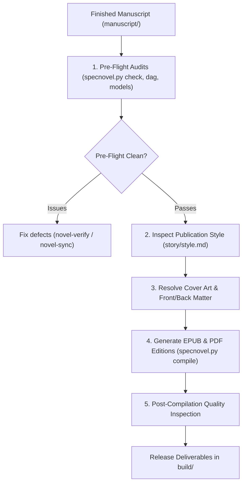

# Novel-Publish

`novel-publish` is the release and publication stage of the SpecNovelist lifecycle.
It transforms the verified prose from `manuscript/` and the asset repository into
distribution-ready digital (**EPUB**) and print (**PDF**) book editions.

All publication formatting—trim size, gutter margins, typography, scene break glyphs,
drop caps, and EPUB styling—is strictly governed by `story/style.md` > `## Publication & Book Design Guidelines`.

* **Publication guide**: [publication-guide.md](references/publication-guide.md)
* **Helper tool**: `python <toolkit>/scripts/specnovel.py compile <options>`

---

## The Publication Lifecycle



---

## Workflow Steps

### 1. Pre-Flight Quality & Integrity Audit
Never publish unverified drafts. Run the pre-flight audit suite:
```bash
python scripts/specnovel.py check
python scripts/specnovel.py dag
python scripts/specnovel.py models
python scripts/specnovel.py stats
```
Verify that:
- `specnovel.py check`: Zero missing scenes, zero dangling wiki-links, no raw `[[ID]]` leaks in prose, and valid metadata.
- `specnovel.py dag`: Story DAG is acyclic and reading order coherence is preserved.
- `specnovel.py models`: All contributing AI models are transparently acknowledged in `story/acknowledgements.md`.
- `specnovel.py stats`: Manuscript word count satisfies the brief's targets.

### 2. Inspect Publication & Book Design Guidelines
Inspect `story/style.md` > `## Publication & Book Design Guidelines`:
- **Trim Size & Margins**: Confirm page proportions (e.g. `5.5in x 8.5in` trade paperback) and gutter margins (`0.75in` inner binding margin).
- **Interior Typography**: Verify selected body font (e.g. *EB Garamond*), heading font (e.g. *Cinzel*), base size (`11pt`), leading (`1.35`), and paragraph indentation (`1.25em`).
- **Scene Break Ornament**: Verify the chosen divider glyph (`* * *`, `❦`, `✦`).
- **Chapter Openings**: Verify recto opening policy (`recto` vs `next`).
- **EPUB Styling**: Verify reflowable settings, TOC depth (`2`), and dark mode CSS variables.

### 3. Resolve Cover Art & Visual Assets
- **Cover Image**: Ensure the cover image exists at `graphics/cover.png` (or `graphics/cover.<locale>.png` for multilingual editions), or at the path defined in `cover_asset`. If unrendered, trigger `novel-sync` with `--stage graphics`.
- **Interior Illustrations**: Ensure all active graphics referenced by the Story DAG exist in `graphics/` and match the locale of each edition.

### 4. Execute Publication Compilation
Compile for each target format and locale using `specnovel.py compile`:

#### A. Compile EPUB Edition (E-Readers: Kindle, Kobo, Apple Books)
```bash
python scripts/specnovel.py compile --format epub --locale en-US
```
- Automatically generates responsive `build/epub.css` matching `story/style.md` typography.
- Injects `cover.png` as the metadata cover image (`--epub-cover-image`).
- Embeds TOC navigation (Parts and Chapters) while omitting scene headings from reader menus.
- Injects foreword, glossary (`GLS`), DAG-filtered bibliography, and verbatim acknowledgements.

#### B. Compile PDF Edition (Print-on-Demand & Interior Proofs)
```bash
python scripts/specnovel.py compile --format pdf --locale en-US
```
Or specify a preferred PDF engine:
```bash
python scripts/specnovel.py compile --format pdf --pdf-engine weasyprint --locale en-US
# or --pdf-engine xelatex
```
- Formats page geometry using `geometry` (trim size, gutter margin, top/bottom margins).
- Implements recto/verso running headers and folios.
- Sets body typeface, line height, and unindented lead-in paragraphs.

#### C. Multilingual Editions
If `story/config.md` defines multiple target languages, compile each locale edition:
```bash
python scripts/specnovel.py compile --format epub --locale fr-FR
python scripts/specnovel.py compile --format pdf --locale fr-FR
```
Outputs localized deliverables: `build/manuscript.fr-FR.epub` and `build/manuscript.fr-FR.pdf`.

#### D. Review Clean Markdown & DOCX Proofs
```bash
python scripts/specnovel.py compile --format md
python scripts/specnovel.py compile --format docx
```

### 5. Post-Compilation Quality Inspection
Inspect the generated deliverables in `build/`:
1. **File Size & Assets**:
   - Verify EPUB file size is within distributor limits (e.g. Amazon KDP < 50MB).
   - Ensure all images are properly scaled and rendered.
2. **EPUB Validation**:
   - Check navigation hierarchy in an e-reader app (Apple Books, Calibre, Kindle Previewer).
   - Verify dark mode rendering (text remains legible without inverted color blocks).
3. **PDF Page Inspection**:
   - Check margins (gutter margin on inner spine edge alternates correctly between even/odd pages).
   - Check chapter drop sinks (space above chapter title).
   - Ensure no orphan or widow single-line paragraphs appear at page boundaries.
   - Verify front matter (Title, Copyright, Foreword) and back matter (Glossary, Bibliography, Acknowledgements).

---

## Publication Command Reference

| Command | Output File | Description |
|---|---|---|
| `specnovel.py compile --format epub` | `build/manuscript.epub` | Distribution-ready EPUB with custom CSS and embedded cover. |
| `specnovel.py compile --format pdf` | `build/manuscript.pdf` | Formatted PDF interior for print-on-demand or reading. |
| `specnovel.py compile --format docx` | `build/manuscript.docx` | Formatted Word document for editorial proofreading. |
| `specnovel.py compile --format md` | `build/manuscript.md` | Consolidated Markdown book in reading order. |
| `specnovel.py compile --locale fr-FR` | `build/manuscript.fr-FR.*` | Localized book edition for target locale. |

---

## Rules

1. **Pre-Flight Mandatory**: Never publish or compile deliverables if `specnovel.py check` or `specnovel.py dag` report errors.
2. **Zero Leaked Markup**: The compiled book must never contain raw `[[ID]]` wiki-links, bracket placeholders, or HTML comment notes.
3. **Verbatim Acknowledgements**: The published edition must always contain the verbatim text of `story/acknowledgements.md`, disclosing all contributing AI models.
4. **Style-Governed Design**: Never hardcode typesetting choices on the command line that conflict with `story/style.md` > `## Publication & Book Design Guidelines`. If the layout needs adjustment, update the style guide first.
