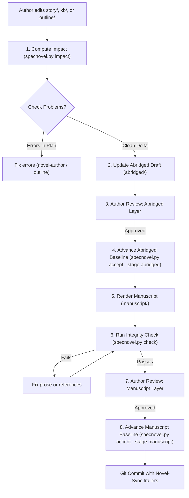

# Novel-Sync

`novel-sync` is the core execution engine of the SpecNovelist **Spec-as-Source** methodology.

In SpecNovelist:
- **`story/`**, **`kb/`**, and **`outline/`** represent the **specification (Source of Truth)**.
- **`abridged/`** and **`manuscript/`** represent the **derived artifacts (Generated/Compiled Text)**.

When you modify a character's secret, relocate a scene, revise a historical fact, or adjust the
outline, `novel-sync` calculates the exact impact radius, reconciles `abridged/`, renders
`manuscript/`, verifies continuity and integrity, and advances the project baselines.

* **Detailed synchronization protocol**: [sync-protocol.md](references/sync-protocol.md)
* **Helper script**: `python <toolkit>/scripts/specnovel.py <command>`

---

## The Parallel Synchronization Baselines

SpecNovelist operates with **seven decoupled, parallel sync stages**, each tracked via Git commit trailers (`Novel-Sync: <stage>`):

1. **`brief`**: Inception & premise decisions (`story/synopsis.md`, `story/brief.md`).
2. **`research`**: Empirical grounding (`kb/research/`, `kb/sources/`, `kb/facts/`).
3. **`bible`**: Story bible canon (`kb/characters/`, `kb/places/`, `kb/plot/`, `kb/world/`, `kb/timeline/`, etc.).
4. **`outline`**: Structural skeleton in reading order (`outline/outline.md`).
5. **`graphics`**: Graphical asset renderings (`graphics/`, from `kb/graphics/`).
6. **`abridged`**: Condensed intermediate novel (`abridged/`).
7. **`manuscript`**: Polished literary prose (`manuscript/`, `story/style.md`, `story/editorial/`).

Whenever the author updates `story/synopsis.md` or `story/brief.md` during the novel's lifecycle (decoupled from `novel-init`), `specnovel.py delta --stage brief` isolates the exact changes, allowing `novel-sync` to propagate changes cleanly downstream through `research`, `bible`, `outline`, `graphics`, and the drafts.

---

## The Synchronization Lifecycle



---

## Workflow Steps

### 1. Inspect Delta and Impact
Always start by checking pending changes and impact against the last sync baselines:
```bash
python scripts/specnovel.py status
python scripts/specnovel.py impact --stage graphics
python scripts/specnovel.py impact --stage abridged
python scripts/specnovel.py impact --stage manuscript
```
- `specnovel.py impact --stage graphics` evaluates all `GFX` definitions in `kb/graphics/`.
  - **Token optimization**: Only graphics entities referenced by the Story DAG (active in scenes or prerequisites) are rendered. Inactive assets are skipped to conserve AI tokens.
  - **Per-asset tracking**: Baselines are tracked per asset (`Novel-GFX-Sync: GFX-NNN`). When an asset is newly re-referenced in the DAG, the engine immediately reports how far out of sync it is (`X commits behind`) and which upstream dependencies changed.
- `specnovel.py impact` automatically flags scenes with pending upstream spec edits as well as
  scenes with active, open editorial directives (`EDT`) in `story/editorial/`.
- If duplicate IDs, dangling references, or unnested scenes exist, resolve them before proceeding.
- If code drift exists in `abridged/` or `manuscript/` from manual edits outside a sync, review those
  changes so intentional modifications are incorporated or preserved.

### 2. Formulate the Synchronization Plan
Present a clear, step-by-step plan to the author:
1. **Upstream changes**: List what changed in `story/`, `kb/`, or `outline/`.
2. **Graphics assets to (re)render in `graphics/`**: Active assets needing generation or updates.
3. **Impacted scenes in `abridged/`**: Which scenes must be newly created, re-abridged, or deleted.
4. **Impacted scenes in `manuscript/`**: Which scenes must be newly rendered or updated.
5. **Global notes**: Any cross-cutting changes (e.g. style guide revisions) that require global attention.

### 3. Synchronize Graphical Assets (`graphics/`)
For each asset flagged under `impact --stage graphics`:
- Generate or render the image/diagram asset specified in `kb/graphics/GFX-xxx.md`.
- Place rendered file in `graphics/` (e.g. `graphics/GFX-001.png` or target path).
- Advance the graphics baseline:
  ```bash
  python scripts/specnovel.py accept --stage graphics -m "Render graphical assets"
  # Or accept a specific asset:
  python scripts/specnovel.py accept --stage graphics --asset GFX-001 -m "Render harbor map"
  ```
- This records a `Novel-GFX-Sync: GFX-xxx` Git trailer for active assets.

### 4. Synchronize the Abridged Layer (`abridged/`)
For each scene flagged under `impact --stage abridged`:
- Use the `novel-abridge` skill conventions.
- Update or draft the scene under `abridged/CHP-xxx.md`.
- Embed active rendered graphics from `graphics/` (``).
- Ensure all plot beats and key dialogue from the revised outline are present.
- If an outline scene was removed, prune it from `abridged/`.

### 5. Author Review Gate: Abridged Layer
Present a concise summary of the abridged changes to the author:
- Highlight the updated plot turns, character actions, and dialogue.
- Ask for confirmation to proceed.
- If the author provides feedback requiring changes to plot or character motivation, hand off to
  `novel-author` or `novel-outline` to adjust the spec first.
- If approved, commit the abridged baseline:
  ```bash
  python scripts/specnovel.py accept --stage abridged -m "Sync abridged: <summary>"
  ```

### 6. Synchronize the Manuscript Layer (`manuscript/`)
For each scene flagged under `impact --stage manuscript`:
- Use the `novel-write` skill conventions.
- Read the updated abridged scene, `story/style.md`, and referenced `kb/` entries (`PLC`, `FCT`, `CHR`, `WLD`).
- Embed active rendered graphics from `graphics/` with literary captions.
- Render the full literary prose under `manuscript/CHP-xxx.md`.
- Match target word count budgets (`specnovel.py stats`).
- If an outline scene was removed, prune it from `manuscript/`.

### 7. Automated Validation and Integrity Check
Run:
```bash
python scripts/specnovel.py dag
python scripts/specnovel.py check
python scripts/specnovel.py stats
```
Verify that:
- Story Causality DAG is acyclic, reading order coherence is preserved (all prerequisites precede their dependents), and every element has a path to the root denouement.
- Every scene in the outline exists in both `abridged/` and `manuscript/` in the correct reading order.
- All active graphics referenced by the Story DAG exist on disk under `graphics/`.
- No dangling references or orphan scenes exist.
- No raw `[[ID]]` tags appear in the visible manuscript prose.
- Fact citations and source records remain valid.

### 8. Author Review Gate: Manuscript Layer
Present the rendered manuscript scenes, word count pacing, and diffs to the author.
Ask the author to review and approve the text.
- If the author requests minor prose refinements, edit `manuscript/` to polish voice and rhythm.
- If the author requests changes to plot, character actions, or factual events, guide the author
  to adjust the spec first, then re-sync.

### 9. Accept the Synchronization
Once the author approves and all integrity checks pass:
- If this synchronization resolved open editorial directives (`EDT`), update their `Status:` to `applied`
  and record the commit baseline in `Resolution:`.
- Commit the baseline:
```bash
python scripts/specnovel.py accept --stage manuscript -m "Sync manuscript: <summary>"
```
Or, if synchronizing all stages simultaneously:
```bash
python scripts/specnovel.py accept --stage all -m "Sync full novel: <summary>"
```
This stages `story/`, `kb/`, `outline/`, `graphics/`, `abridged/`, `manuscript/` and records a Git commit with
structured `Novel-Sync:` and `Novel-GFX-Sync:` trailers.
```git
novel-sync(abridged, manuscript): Update collision aftermath

Novel-Sync: abridged, manuscript
Novel-Modified: SCN-014, CHR-003
Novel-Abridged-Updated: SCN-014
Novel-Manuscript-Updated: SCN-014
```
This commit becomes the new baseline for future deltas.

---

## Rules

1. **Spec is Primary**: Never edit `abridged/` or `manuscript/` to alter plot events, character
   fates, or historical facts without updating `story/`, `kb/`, or `outline/` first.
2. **Sequential Compilation**: Always update and review `abridged/` before rendering `manuscript/`.
   Never skip the abridged layer.
3. **No Phantom Scenes**: Only scenes defined in `outline/` may exist in `abridged/` and `manuscript/`.
4. **Git Baseline Integrity**: Use `specnovel.py accept` to commit baselines so that future changes
   are accurately tracked and diffed.
