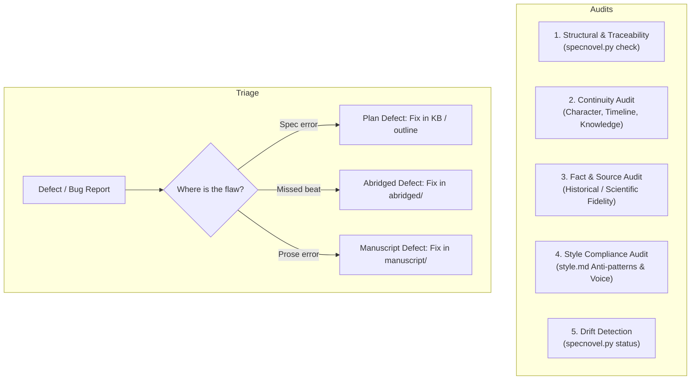
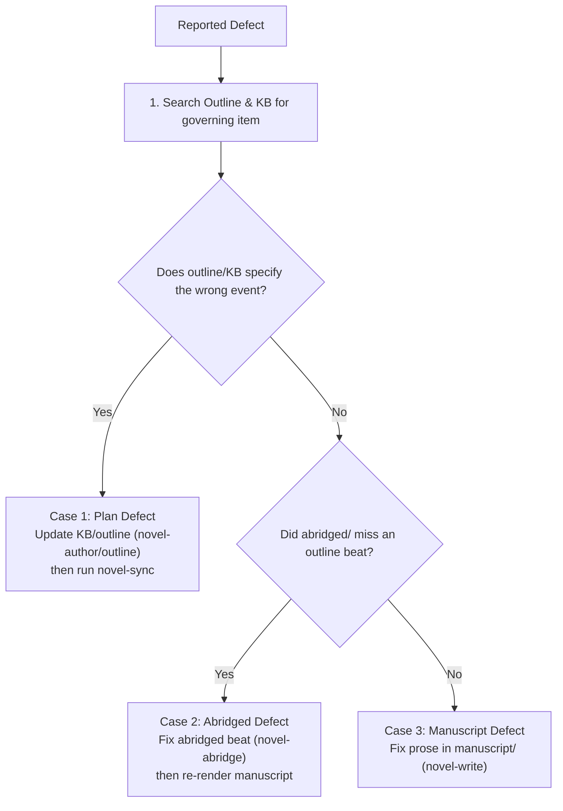

# Novel-Verify

`novel-verify` is the diagnostic and quality-assurance engine of the SpecNovelist methodology.
It audits alignment between the specifications (`story/`, `kb/`, `outline/`) and the derived
narrative drafts (`abridged/` and `manuscript/`).

* **Verification checklists**: [audit-checklists.md](references/audit-checklists.md)
* **Helper**: `python <toolkit>/scripts/specnovel.py <command>`

---

## Capabilities & Audits



---

## 1. Structural, Traceability, and Causality Audit
Run the automated integrity suite:
```bash
python scripts/specnovel.py check
python scripts/specnovel.py dag
```
Verifies:
- **Story Causality & Reading Order Coherence**:
  - **Acyclicity**: Causality graph is a strict DAG with zero cycles.
  - **Reading Order**: Every element in the outline is preceded by all its prerequisites.
  - **Denouement Essentiality**: Every element in the story has a directed causal path to the novel's final denouement root (no dead-ends or inessential scenes).
- **Integrity & References**:
  - All cataloged IDs are unique across the project.
  - No dangling wiki-links (`[[ID]]`) exist.
  - All plot elements (`PLT`) carry valid Time and Place metadata for transition clarity.
  - All editorial directives (`EDT`) carry valid Target, Stage, and Status metadata.
  - All researched facts (`FCT`) cite valid source records (`SRC`).
  - Every source has an accessible URL or full bibliographic citation.
  - Derived chapters and scenes in `abridged/` and `manuscript/` match the outline in order and hierarchy.
  - No visible `[[ID]]` markup leaks into final manuscript prose.

To inspect the traceability and usage matrix for any character, place, or fact:
```bash
python scripts/specnovel.py trace CHR-001
python scripts/specnovel.py trace FCT-030
```
Shows where the item is defined, what other items reference it, and every scene in reading order
where it appears.

---

## 2. Continuity Audit

Continuity errors break reader immersion. Run targeted continuity audits across scenes:

### A. Character Continuity
- **Physical Traits**: Check character hair, eye color, height, scars, handedness, and injuries
  against the `Continuity` section of their `CHR` entry. Ensure wounds take realistic time to heal.
- **Forms of Address & Aliases**: Verify that characters use period-appropriate forms of address
  matching their social relationship in `CHR`.

### B. Timeline & Chronology Audit
- **Calendar & Travel**: Check scene dates (`When:`) against `kb/timeline/timeline.md`.
  Verify that travel times between locations (`PLC`) are physically possible given the era's
  technology (steam trains, horses, walking, ocean liners).
- **Ages**: Check character ages against their birth dates in `CHR`.

### C. Information & Epistemic Audit
- **Who knows what, when?**: Track secrets and reveals in `PLT`.
- Ensure characters do not act on information they have not yet acquired in the narrative.
- Ensure dramatic ironies are maintained without accidental slip-ups.

---

## 3. Fact & Source Fidelity Audit

Audits whether the manuscript honors the researched facts cataloged in `kb/facts/`:
1. **Fact Check**: For any historical event, scientific procedure, legal process, or period object
   appearing in a scene, trace its `[[FCT-...]]` link. Verify that the scene details conform to the
   fact's statement and sources.
2. **Anachronism Scan**:
   - Check dialogue and narration for modern idioms, slang, or concepts that post-date the setting.
   - For historical settings, verify suspect words against historical etymology and first-use records.
3. **Documented Liberties**:
   - Check if the scene deviates from known history or science.
   - If a deviation is intentional, verify that the fact has a documented `Liberty:` note (so it can
     be included in the book's Author's Note). If unintentional, flag it as a defect.

---

## 4. Style Compliance Audit

Audits `manuscript/` against `story/style.md`:
1. **Anti-pattern Scan**:
   - Search manuscript files for forbidden clichés, filter words ("she heard", "he felt"), and
     generic AI-isms ("tapestry", "testament to", "breath she didn't know").
2. **Dialogue Tag Discipline**:
   - Verify that dialogue tags adhere to `style.md` rules (e.g. no adverbs on tags; action beats instead
     of exotic verbs like *"retorted", "expounded"*).
3. **POV and Tense Consistency**:
   - Ensure the prose maintains the specified POV (e.g. close third, past tense) without accidental
     head-hopping or tense slippage.
4. **Sentence Rhythm & Pacing**:
   - Check that action scenes use crisper sentence cadence, and reflective scenes allow deeper interiority.

---

## 5. Drift Detection

To detect manual changes made directly to drafts without updating the specification:
```bash
python scripts/specnovel.py status
```
If the output lists modified files in `abridged/` or `manuscript/` when no sync is in progress:
1. Review the diff against the baseline (`git diff <baseline> -- abridged/ manuscript/`).
2. If the edits were intentional narrative changes:
   - If an author changed a plot event, character decision, or dialogue line in `abridged/` or `manuscript/`,
     inform the author:
     > *"In SpecNovelist, narrative truth originates in the plan (kb/ and outline/)."*
   - Offer to backport those changes into `outline/` or `kb/` (using `novel-author` or `novel-outline`),
     then accept the sync baseline.
3. If the edits were unintended drift, offer to restore the files to the clean baseline.

---

## 6. Bug & Defect Triage

When the author or a reader reports an issue (e.g. *"In Chapter 4, Karl knows about the police raid before the telegram arrives"*):



1. **Case 1: Plan Defect (The spec is wrong or contradictory)**:
   - The outline or KB mandated contradictory timing or impossible behavior.
   - **Do not touch prose directly**. Propose the corrected `TML`, `CHR`, or `SCN` beat in the plan.
   - Once approved, trigger `novel-sync` to propagate the fix cleanly.
2. **Case 2: Abridged Defect (The outline was right, but abridged drifted)**:
   - The outline specified the correct sequence, but `abridged/` dropped a key beat or misstated dialogue.
   - Fix `abridged/`, verify that the beat works, then re-render the manuscript scene via `novel-sync`.
3. **Case 3: Manuscript Defect (The plot is correct, but prose execution failed)**:
   - The abridged draft was correct, but the manuscript prose introduced an anachronism, a style
     violation, or a confusing sentence.
   - Fix the prose directly in `manuscript/` and verify word counts and style rules.

---

## Rules

- Never fix a plot or continuity error by editing `manuscript/` alone; root causes must be fixed
  in the upstream specification.
- Never dismiss anachronisms or fact contradictions without checking if the author intended a
  deliberate `Liberty:`.
- Always verify all downstream effects with `specnovel.py trace <ID>`.
