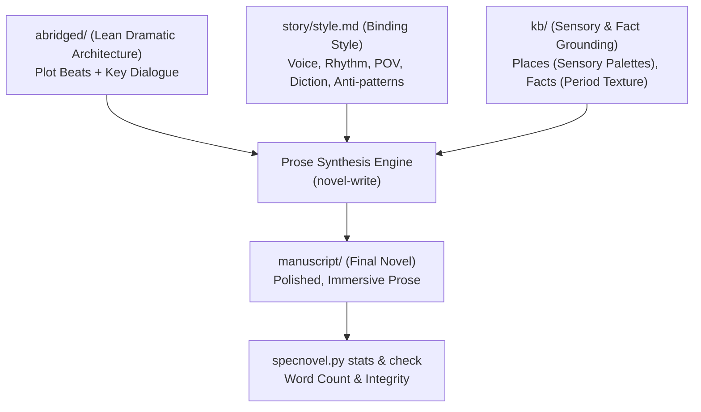

# Novel-Write

`novel-write` is the prose rendering engine of SpecNovelist. It transforms the lean dramatic
architecture of `abridged/` into the rich, immersive, polished prose of `manuscript/`.

Every sentence generated by `novel-write` is governed by **three inputs**:
1. **The Dramatic Architecture (`abridged/`)**: The plot actions, character decisions, conflict,
   blocking, and dialogue must be honored with complete fidelity. No plot beats are skipped, and
   no unauthorized subplots are invented.
2. **The Style Guide (`story/style.md`)**: The binding authority on voice, point of view, tense,
   sentence rhythm, diction, sensory density, interiority depth, and forbidden anti-patterns.
3. **The Knowledge Base (`kb/`)**: Characters' distinct speech cadences, emotional wounds, and
   secrets (`CHR`); places' sensory palettes, light, and layout (`PLC`); authentic period facts,
   scientific procedures, and daily-life textures (`FCT`); and world rules (`WLD`).

* **Prose rendering guidelines**: [prose-craft.md](references/prose-craft.md)
* **Writing style guide template**: `story/style.md`
* **Helper**: `python <toolkit>/scripts/specnovel.py <command>`

---

## Workflow



### 1. Identify Scenes to Render
Run:
```bash
python scripts/specnovel.py impact --stage manuscript
```
`impact` flags:
- Scenes present in `abridged/` that have not yet been rendered in `manuscript/`.
- Scenes whose abridged source text was modified.
- Scenes whose referenced `kb/` items (`FCT`, `PLC`, `CHR`, `WLD`) changed.
- Global style updates: if `story/style.md` was edited, all rendered scenes are flagged for review.

### 2. Pre-Flight Verification
Run:
```bash
python scripts/specnovel.py check
```
- If `story/style.md` is missing or contains fewer than 400 words of concrete guidance, `check`
  warns that the style guide is too thin. Complete `story/style.md` before rendering prose.
- Ensure the corresponding chapter and scene exist in `abridged/`. `novel-write` never generates
  prose directly from an outline without an abridged draft.

### 3. Load Context per Scene
For each target scene (`SCN-xxx`):
1. **Read `abridged/CHP-xxx.md`**: Isolate the scene's abridged narrative. Note every action beat,
   every line of dialogue, and the final emotional/value shift.
2. **Read `story/style.md`**: Review:
   - POV person, tense, and psychic distance.
   - Sentence length distribution and paragraph cadence.
   - Dialogue tag rules (e.g. *"said/asked only; no adverbs"*).
   - Sensory priorities and metaphor guidelines.
   - Anti-patterns and banned words/tropes.
   - Touchstone passages and voice anchors.
3. **Read referenced `kb/` entries**:
   - `PLC`: Sights, sounds, smells, temperatures, and spatial boundaries.
   - `CHR`: Physical mannerisms, emotional state, secrets, and speech habits.
   - `FCT`: Sourced textures, period-accurate objects, specialized vocabulary, procedures.
   - `WLD`: Physical constraints of speculative rules.
4. **Target word count**: Check the scene's target word count in `outline/` (or via `specnovel.py stats`).

### 4. Synthesize the Manuscript Scene
Draft the prose under `manuscript/CHP-xxx.md`:
- **Preserve 100% of the Plot and Dialogue**: Retain all dialogue lines from the abridged draft,
  enriching beats with physical action, micro-expressions, pauses, and subtext.
- **Sensory Immersion**: Anchor the reader in the physical reality of the scene using the sensory
  palette from `PLC` and historical details from `FCT`. Avoid generic descriptions.
- **Filter Exposition through the POV**: Researched facts must never read like encyclopedia
  entries. Deliver them through what the POV character notices, uses, or worries about.
- **Enforce Style Constraints**: Strictly observe every rule in `story/style.md`. Do not slip into
  clichés, generic AI syntax ("a testament to", "tapestry of"), or modern idioms in historical settings.
- **Clean Output**: Do not leave raw wiki-style tags (`[[CHR-001]]`) visible in the prose. Use natural
  character names and descriptions. (Markdown comments `<!-- note -->` may be retained if needed).

### 5. Validate and Audit
Run:
```bash
python scripts/specnovel.py check
python scripts/specnovel.py stats --scenes
```
Verify that:
- Word counts match targets within acceptable margins (typically ±15%).
- No visible `[[ID]]` markup remains in the body prose.
- Scene sequence and chapter headings match the outline and abridged drafts.

### 6. Author Review and Baseline
Present the rendered scenes to the author:
- Highlight how voice anchors and style rules were applied.
- Show word counts and chapter pacing.
- Once approved, commit the manuscript baseline:
  ```bash
  python scripts/specnovel.py accept --stage manuscript -m "Render manuscript for chapter 1"
  ```

---

## Golden Rules of Novel-Write

1. **The Abridged Draft is King for Plot**: You may not alter the outcome, add new confrontations,
   skip beats, or drop dialogue present in `abridged/`. If the plot needs to change, change it in
   the outline and abridged drafts first.
2. **The Style Guide is King for Voice**: Never revert to generic "smooth AI prose". If `style.md`
   calls for short, staccato sentences and gritty diction, write short, staccato sentences with
   gritty diction.
3. **Show Researched Facts Through Action**: Characters do not lecture each other on things they
   both already know. Sourced facts enter the scene through physical interaction, sensory friction,
   or pressing dramatic problems.
4. **Zero Visible Metadata**: The manuscript must read as an authentic published book. All IDs,
   references, and diagnostic markers are stripped from the prose.
