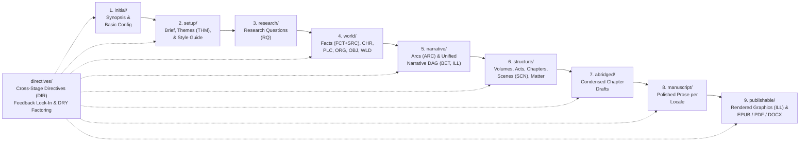

# SpecNovelist

**SpecNovelist** is a Git-native, **Spec-as-Source** toolkit and agent skill suite for writing long-form fiction. All project data is organized into a **9-stage pipeline** plus a cross-stage **`directives/`** repository where upstream specifications are the single source of truth and downstream drafts and deliverables are incrementally generated and synchronized.

---

## 1. The 9-Stage Pipeline & Directives Architecture



### Directory Layout
```text
<project-root>/
├── initial/                    # Stage 1: Initial
│   ├── synopsis.md             # Seed synopsis
│   └── config.md               # Author identity, target locales, compilation toggles
├── setup/                      # Stage 2: Setup
│   ├── brief.md                # Creative interview decisions & word count targets
│   ├── themes.md               # Thematic pillars (THM-NNN)
│   └── style.md                # Binding style guide, graphics rules, & locale rules
├── research/                   # Stage 3: Research Questions
│   └── questions.md            # World-building research questions (RQ-NNN)
├── world/                      # Stage 4: World
│   ├── facts/                  # Sourced facts answering RQs (FCT-NNN)
│   ├── sources/                # Verified bibliographic sources (SRC-NNN)
│   ├── characters/             # Character dossiers (CHR-NNN)
│   ├── places/                 # Locations & sensory palettes (PLC-NNN)
│   ├── organizations/          # Factions & institutions (ORG-NNN)
│   ├── objects/                # Key artifacts & Chekhov items (OBJ-NNN)
│   ├── rules/                  # World rules & systems (WLD-NNN)
│   ├── timeline/               # Chronological events (TML-NNN)
│   └── glossary/               # Glossary entries (GLS-NNN)
├── narrative/                  # Stage 5: Narrative Structure
│   ├── arcs.md                 # Story arcs (ARC-NNN)
│   ├── beats.md                # Narrative beats (BET-NNN) in the Narrative DAG
│   └── illustrations.md        # Textual illustration nodes (ILL-NNN) in the Narrative DAG
├── structure/                  # Stage 6: Physical Structure
│   ├── outline.md              # Volumes (VOL), Acts (ACT), Chapters (CHP), Scenes (SCN)
│   ├── front-matter/           # Optional foreword / dedication
│   └── back-matter/
│       └── acknowledgements.md # Mandatory verbatim AI & contributor acknowledgements
├── abridged/                   # Stage 7: Abridged Novel
│   └── CHP-NNN.md              # Condensed chapter drafts with all beats & key dialogue
├── manuscript/                 # Stage 8: Manuscript
│   └── <locale>/CHP-NNN.md     # Polished prose per target locale
├── publishable/                # Stage 9: Publishable Material
│   ├── graphics/               # Rendered graphical assets (ILL-NNN[.<locale>].png)
│   └── <locale>/               # Compiled books (.md, .docx, .epub, .pdf)
└── directives/                 # Cross-Stage Directives Repository
    └── DIR-NNN.md              # Persistent instructions for feedback lock-in & DRY factoring
```

---

## 2. Three Operational Skill Categories (+ Diagnostics)

| Category | Skill | Purpose |
|---|---|---|
| **1. Generation** | **`novel-generate`** | Generates initial data for a target stage (`1..8`) from earlier stages and guided author interview questions (always offering explicit decline/delegate paths). Automatically uses `directives/` (`DIR-NNN`) for DRY factoring of shared instructions and commits the stage baseline. |
| **2. Synchronization** | **`novel-sync`** | Incrementally updates a stage (`1..8`) based on edits to earlier stages. Enforces the **Generation Gate** (cannot run until `novel-generate` has been accepted at least once for that stage), respects and preserves existing `[[DIR-NNN]]` links on updated records, auto-links relevant directives to newly created records, and factors shared instructions into directives. |
| **3. Feedback** | **`novel-feedback`** | Processes freeform user feedback to edit upstream stage data and creates/links `DIR-NNN` directives so user feedback remains locked in across future synchronizations. |
| **Diagnostic** | **`novel-verify`** | Audits Beat DAG acyclicity/denouement essentiality, topological physical serialization, fact fidelity, directive preservation, epistemic integrity, and style compliance. |
| **Diagnostic** | **`novel-analyze`** | Generates metrics-focused editorial and style analysis reports (`specnovel.py audit --report`), comparing style-reflective metrics against `setup/style.md`. |

---

## 3. CLI Reference (`scripts/specnovel.py`)

| Command | Description |
|---|---|
| `uv run python scripts/specnovel.py init <path> --title "<Title>"` | Scaffold a new 8-stage + `directives/` SpecNovelist project. |
| `uv run python scripts/specnovel.py next-id <PREFIX>` | Allocate the next permanent ID (`THM`, `RQ`, `FCT`, `SRC`, `CHR`, `PLC`, `ORG`, `OBJ`, `WLD`, `TML`, `GLS`, `ARC`, `BET`, `ILL`, `VOL`, `ACT`, `CHP`, `SCN`, `DIR`). |
| `uv run python scripts/specnovel.py status` | Inspect catalog counts, stage generation/sync baselines, and scene coverage. |
| `uv run python scripts/specnovel.py check` | Run full integrity checks (Beat DAG, topological outline order, sourced facts, directive preservation, AI model acknowledgements). |
| `uv run python scripts/specnovel.py dag` | Validate Stage 4 Beat DAG (`Place`, `Time`, `Arcs`, `Dependencies`, `Denouement`) and Stage 5 topological serialization. |
| `uv run python scripts/specnovel.py delta --stage <stage>` | Show upstream file changes since `<stage>` was last accepted (enforces Generation Gate). |
| `uv run python scripts/specnovel.py impact --stage <stage>` | Compute specific scenes, chapters, or illustrations impacted by upstream changes (enforces Generation Gate). |
| `uv run python scripts/specnovel.py directives list` | List all cataloged `DIR-NNN` directives. |
| `uv run python scripts/specnovel.py directives link --apply` | Automatically link relevant pre-existing `DIR-NNN` directives to records matching their `Scope:`. |
| `uv run python scripts/specnovel.py directives factor --title "..." --scope "..." --instruction "..." --targets ID1 ID2` | Factor a shared instruction into a single-source-of-truth `DIR-NNN` and link it to all target records. |
| `uv run python scripts/specnovel.py accept --stage <stage> --model "<Model>"` | Auto-link directives on new records, commit changes, and record `Novel-Sync: <stage>` baseline. |
| `uv run python scripts/specnovel.py audit [--report]` | Compute developmental and style-reflective telemetry and generate a Markdown analysis report. |
| `uv run python scripts/specnovel.py compile --format all` | Compile deliverables into `publishable/<locale>/`. |
