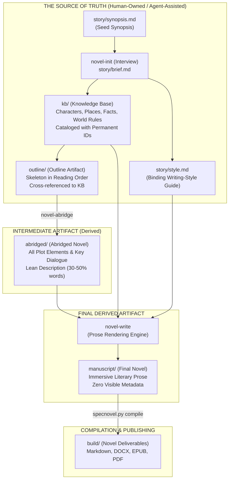
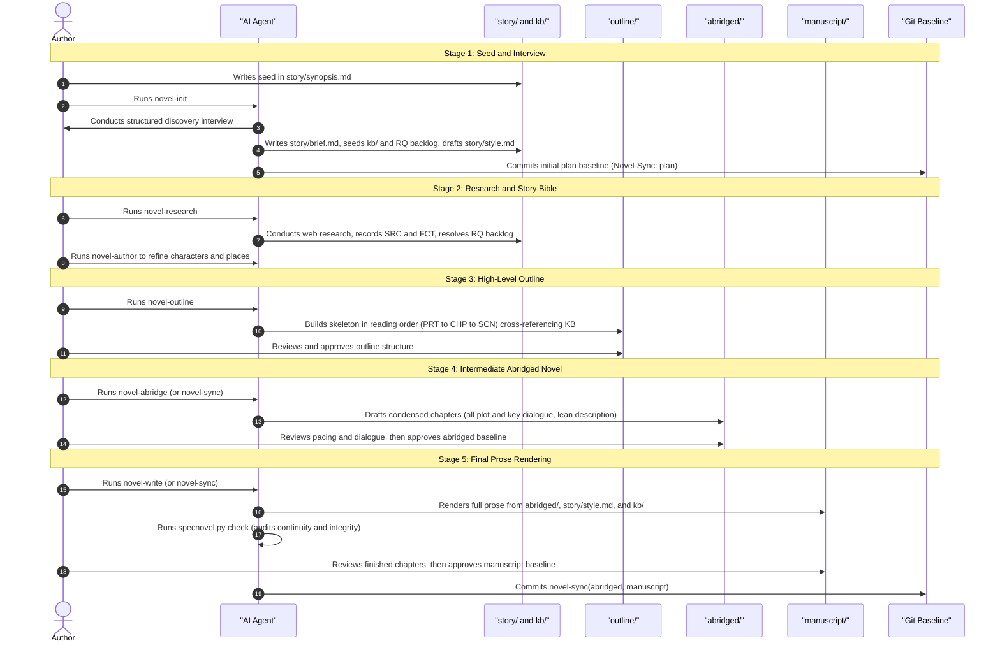
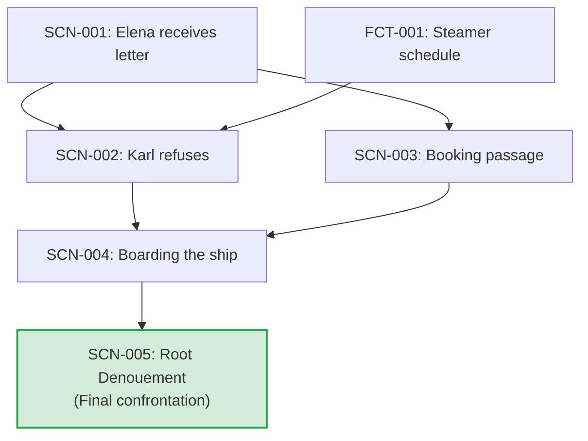
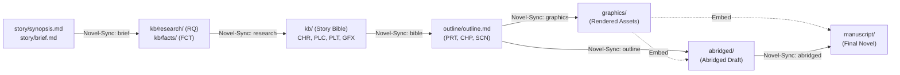

# SpecNovelist: Specification-First Fiction Writing with AI Agents

**SpecNovelist** is an AI-native writing methodology and toolkit adapted from the **SpecDrive**
specification-driven software engineering paradigm. In SpecNovelist, **structured story specifications,
researched knowledge bases, and outlines serve as the primary source of truth**, while the narrative
drafts (abridged and full manuscript) are treated as derived artifacts maintained and compiled by AI agents.

SpecNovelist is specifically designed for writing novels set in **rigorously researched historical,
contemporary, and/or futuristic settings**, where continuity, factual fidelity, narrative causality,
and distinct literary voice must be maintained across tens or hundreds of thousands of words without
context drift or hallucination.

---

## Table of Contents

1. [Core Philosophy & Architecture](#core-philosophy--architecture)
   - [Starting from Scratch: Rough Ideas & Placeholders Guide](STARTING_FROM_SCRATCH.md)
2. [Project Directory Layout](#project-directory-layout)
3. [The Five-Stage Novel Writing Pipeline](#the-five-stage-novel-writing-pipeline)
   - [Stage 1: Seed Synopsis & Interactive Discovery Interview (`novel-init`)](#stage-1-seed-synopsis--interactive-discovery-interview-novel-init)
   - [Stage 2: Knowledge Base Construction & Sourced Research (`novel-author` & `novel-research`)](#stage-2-knowledge-base-construction--sourced-research-novel-author--novel-research)
   - [Stage 3: Intermediate Artifact 1 — The High-Level Outline (`novel-outline`)](#stage-3-intermediate-artifact-1--the-high-level-outline-novel-outline)
   - [Stage 4: Intermediate Artifact 2 — The Abridged Novel (`novel-abridge`)](#stage-4-intermediate-artifact-2--the-abridged-novel-novel-abridge)
   - [Stage 5: Prose Rendering via Style Guide (`novel-write`)](#stage-5-prose-rendering-via-style-guide-novel-write)
4. [Incremental Synchronization & Baselines (`novel-sync`)](#incremental-synchronization--baselines-novel-sync)
5. [Continuity, Fact Verification & Drift Detection (`novel-verify`)](#continuity-fact-verification--drift-detection-novel-verify)
6. [Knowledge Base Catalog & ID Registry](#knowledge-base-catalog--id-registry)
7. [The Authoritative Style Guide (`story/style.md`)](#the-authoritative-style-guide-storystylemd)
8. [CLI Helper Reference (`specnovel.py`)](#cli-helper-reference-specnovelpy)
9. [Adopting SpecNovelist in Host Projects](#adopting-specnovelist-in-host-projects)

---

## Core Philosophy & Architecture

### The Problem in AI-Assisted Novel Writing
Unstructured "vibe-writing" and simple conversational prompting invariably fail over novel-length works:
- **Context Drift & Hallucination**: Character traits (eye color, age, wounds), timeline dates, and
  established facts mutate across chapters as the LLM's context window shifts.
- **Unearned Plot Leaps**: AI skips essential narrative steps, rushing from premise to resolution
  without dramatic causality or emotional turns.
- **Factual Inaccuracy & Anachronisms**: Historical settings suffer from modern jargon and factual
  errors; futuristic settings suffer from magical hand-waving without grounded scientific constraints.
- **Homogenized Voice**: Prose degenerates into generic, overly explanatory "AI prose" filled with
  recurrent clichés (*"a testament to", "tapestry of", "let out a breath she didn't know she was holding"*).

### The Solution: Spec-as-Source for Fiction
SpecNovelist solves this by establishing **Specifications as Source (Spec-as-Source)**:



- **Spec is Primary**: Plot structure, character continuity, world rules, and researched facts live in
  version-controlled Markdown under `story/`, `kb/`, and `outline/`.
- **Drafts are Derived**: `abridged/` and `manuscript/` are derived from the specs. When you want to
  change what happens in the story, you edit the spec—the AI agent calculates the impact radius and
  re-synchronizes the drafts.
- **Two Distinct Intermediate Artifacts**:
  1. **The High-Level Outline (`outline/`)**: The skeleton in reading order, defining scene beats,
     turning points, fact constraints, and key dialogue.
  2. **The Abridged Novel (`abridged/`)**: The complete narrative spine containing *all plot elements*
     and *important dialogues*, but with minimal description. This allows rapid author review of pacing
     and dramatic causality before investing in full prose rendering.
- **Binding Style Contract**: The manuscript is generated by combining the abridged novel with a
  thorough, enforceable writing style guide (`story/style.md`).
- **Authoritative Sourcing**: Every real-world fact must cite verified, authoritative sources (prioritizing
  primary sources) cataloged in the knowledge base.
- **Git-Native Baselines**: Sync commits are tracked using Git commit trailers (`Novel-Sync:`).

---

## Project Directory Layout

Every SpecNovelist project conforms to a clean, modular folder structure:

```text
my-novel/
├── story/                      # HUMAN-OWNED INPUTS & SPECIFICATIONS
│   ├── synopsis.md             # The seed synopsis (human-owned; never edited without permission)
│   ├── brief.md                # Discovery interview decisions: premise, genre, length, settings, rigor
│   ├── style.md                # BINDING writing-style guide (voice, rhythm, POV, anti-patterns)
│   └── editorial/              # EDT: Editorial feedback directives (target, stage, status, issue, directive)
├── kb/                         # THE KNOWLEDGE BASE (Cataloged & Cross-Referenced)
│   ├── characters/             # CHR: Characters (fictional & real; voice, arc, continuity)
│   ├── places/                 # PLC: Settings & locations (layouts, sensory palettes)
│   ├── organizations/          # ORG: Institutions, factions, companies
│   ├── objects/                # OBJ: Significant props, heirlooms, vehicles, documents
│   ├── plot/                   # PLT: Main plot, subplots, character arcs, mysteries, secrets
│   ├── themes/                 # THM: Core thematic questions and motifs
│   ├── world/                  # WLD: World rules for futuristic/invented elements (with factual basis)
│   ├── timeline/               # TML: Chronological master timeline of events
│   ├── facts/                  # FCT: Researched, sourced facts (history, science, procedures)
│   ├── sources/                # SRC: Bibliographic records (primary & secondary sources, URLs, dates)
│   ├── research/               # RQ:  Research question backlog
│   └── INDEX.md                # GENERATED master index of all IDs (specnovel.py index)
├── outline/                    # INTERMEDIATE ARTIFACT 1: NOVEL SKELETON
│   └── outline.md              # Reading order: PRT (Parts) > CHP (Chapters) > SCN (Scenes)
├── abridged/                   # INTERMEDIATE ARTIFACT 2: ABRIDGED DRAFT (DERIVED)
│   ├── CHP-001.md              # Condensed chapter: all plot elements & key dialogue, lean description
│   └── CHP-002.md
├── manuscript/                 # FINAL NOVEL PROSE (DERIVED)
│   ├── CHP-001.md              # Finished literary novel chapters rendered via story/style.md
│   └── CHP-002.md
├── build/                      # COMPILED BOOK DELIVERABLES (Git-ignored)
│   ├── manuscript.md           # Assembled novel in reading order
│   └── manuscript.epub / .docx # Formatted books (via pandoc)
├── AGENTS.md                   # Always-on guidelines for AI agents
└── README.md                   # Project documentation
```

---

## The Five-Stage Novel Writing Pipeline



---

### Stage 1: Seed Synopsis & Interactive Discovery Interview (`novel-init`)

Every novel begins with a high-level synopsis written by the author in `story/synopsis.md` (anything
from a single paragraph to several pages).

> [!TIP]
> **Starting from a rough, unresearched idea with placeholders?** Read the step-by-step guide: [**Starting from Scratch: From a Rough Idea to a Spec-Driven Novel**](STARTING_FROM_SCRATCH.md) to learn how to use functional placeholders (`[...]`), Stable Identity Decoupling, and research backlogs before committing to character names, historical details, or period physics.

When the author prompts `novel-init`, the agent executes an **interactive, agent-led discovery interview**:
1. **Reflection**: The agent reflects its understanding of the premise, protagonist, setting eras, and central conflict.
2. **Batched Questions**: The agent leads a 6-phase interview (3–5 questions per turn), **always providing recommended defaults**:
   - **Phase 1: Premise & Scope**: Logline, genre, target word count (e.g. 90,000 words), working title.
   - **Phase 2: Setting & Research Scope**: Historical eras, contemporary "as of" dates, futuristic extrapolations,
     and strictness of research rigor.
   - **Phase 3: Cast**: Protagonists, antagonists, supporting cast, POV distribution, and naming conventions.
   - **Phase 4: Plot Architecture**: Structural model (three-act, four-act, seven-point, mystery), major turning
     points, subplots, and ending resolution.
   - **Phase 5: Theme & Tone**: Thematic questions, recurring motifs, tone shifts, and content boundaries.
   - **Phase 6: Voice & Style**: POV stance, tense, sentence rhythm, dialogue conventions, and touchstone authors.
3. **Synthesis**: The agent populates `story/brief.md`, drafts `story/style.md`, seeds the knowledge base
   (`CHR`, `PLC`, `ORG`, `OBJ`, `PLT`, `THM`, `WLD`), logs open research questions (`RQ`), and establishes the
   initial plan baseline (`specnovel.py accept --stage plan`).

---

### Stage 2: Knowledge Base Construction & Sourced Research (`novel-author` & `novel-research`)

#### Knowledge Base (`novel-author`)
The story bible is cataloged into dedicated markdown files under `kb/`. Every item receives a permanent
alphanumeric ID (`PREFIX-NNN`) and is cross-referenced using wiki-links (`[[CHR-001]]` or `[[CHR-001|Elena]]`).
The agent assists the author in fleshing out character goals/flaws, setting layouts, and plot threads.
- **Mandatory Time & Place on Plot Elements**: Every plot element (`PLT`) must specify valid time (e.g. `Time:`)
  and place (e.g. `Place:`) metadata. Automated checks (`specnovel.py check`) enforce this rule, ensuring that
  `novel-write` has the spatiotemporal boundaries needed to clarify transitions.

#### Authoritative Online Research (`novel-research`)
For all historical, scientific, legal, geographical, and contemporary facts, the agent executes online research:
- **Authoritative Source Hierarchy**:
  1. **Primary Sources**: Official records, government inquiry transcripts, contemporaneous newspapers, diaries,
     letters, original patents, scientific datasets, and period maps.
  2. **Secondary Sources**: Peer-reviewed journal articles, university press monographs, museum curatorial archives.
  3. **Tertiary Sources**: Reference encyclopedias used for orientation only.
  *(Open wikis and AI summaries are never cited as evidence; their citations are mined for original sources).*
- **Verification Rule**: The agent must **read the actual page or document** before citing it. Never cite from
  search snippets or memory.
- **Corroboration**: Major claims require one authoritative primary source or two independent secondary sources.
- **Recording**:
  - The source is recorded in `kb/sources/` (`SRC-xxx`) with Title, Creator, Publisher, URL, Access Date, Full Citation, and Reliability notes.
  - The fact is recorded in `kb/facts/` (`FCT-xxx`) with a clear statement, scope, confidence rating, supporting quotes/locators, and `Story use:` guidance.
  - Sourced facts resolve research questions (`RQ-xxx`) in `kb/research/questions.md`.

---

### Stage 3: Intermediate Artifact 1 — The High-Level Outline (`novel-outline`)

The outline is the **structural skeleton of the novel in reading order** and a **strict serialization of the story causality DAG**.

Built in `outline/outline.md`, it organizes the book into Parts (`PRT`), Chapters (`CHP`), and Scenes (`SCN`):
```markdown
### CHP-004: Night Crossing
- **Purpose:** Escalation toward the midpoint crisis
- **POV:** [[CHR-001]]
- **Span:** 1912-04-14 evening -> 1912-04-15 dawn
- **Target words:** 5500

#### SCN-014: The collision
- **Prerequisites:** [[SCN-006]], [[PLT-001]]
- **When:** 1912-04-14, 23:40 ship's time ([[TML-004]])
- **Where:** [[PLC-007]]
- **POV:** [[CHR-001]]
- **Cast:** [[CHR-001]], [[CHR-003]], an unnamed steward
- **Plot:** escalates [[PLT-001]]; pays off clue from SCN-006 ([[PLT-005]])
- **Facts:** [[FCT-030]], [[FCT-031]]
- **World:** (if speculative) [[WLD-002]]
- **Goal / conflict / outcome:** Elena wants to reach Karl's cabin; barred by a steward; slips past but finds it empty.
- **Beats:**
  1. A faint shudder through the deck; card players ignore it.
  2. The sudden silence as engines stop (per [[FCT-031]]).
  3. Sharp confrontation with the steward at the E-deck gate.
  4. Karl's cabin is deserted; his coat is missing, but the ledger remains.
- **Key dialogue:**
  - Steward: "Nothing to worry about, miss. Go back to bed."
  - Elena: "Then why are your hands shaking?"
- **Change:** Elena moves from irritation to cold panic; realizes Karl fled before the impact.
- **Target words:** 2200
```

#### Story Causality as a Directed Acyclic Graph (DAG)
Narrative causality is modeled formally as a Directed Acyclic Graph:
- **Causal Dependencies (`Prerequisites:`)**: Every scene, plot element, or story-bible fact declares which
  other elements must occur or be established prior to it (`Prerequisites: [[ID]]`).
- **Serialization in Reading Order**: The novel's outline is a serialization of this DAG. For any dependency
  $u \to v$ ($v$ requires $u$), $u$ must appear before $v$ in the outline reading order ($pos(u) < pos(v)$).
- **Multiple Valid Serializations**: A story DAG defines a partial order, admitting multiple valid topological sorts.
  The specific serialization chosen is an artistic decision guided by `story/style.md` to achieve targeted
  dramatic effects: generating suspense (dramatic irony), cross-cutting between parallel threads to land sharp
  cliffhangers, alternating high-tension turns with reflective breathing room, and juxtaposing contrasting scenes
  for thematic resonance.
- **The Denouement Root**: The root of the DAG is the novel's final resolving scene or climax (designated
  by `- **Denouement:** true` or specified in `story/brief.md`).
- **Essentiality (No Dead Ends)**: Every plot element and scene must have a directed causal path to the root
  denouement. Any extraneous subplot or dead-end scene that does not contribute causally to the novel's
  ultimate resolution is flagged and rejected.



Whenever the outline is touched or updated, automated tests are executed via `python scripts/specnovel.py dag`
and `specnovel.py check`:
1. **Cycle Detection**: Validates that no circular causality exists (the graph is truly a DAG).
2. **Reading Order Coherence**: Validates that all prerequisites precede their dependent scenes in the outline.
3. **Essentiality to Root**: Validates that every scene and plot element has a directed path to the root denouement.

---

### Stage 4: Intermediate Artifact 2 — The Abridged Novel (`novel-abridge`)

The **abridged novel** (`abridged/`) is the vital intermediate bridge between the outline and the final prose.

- **What it is**: A complete, readable version of the novel structured into chapter files (`abridged/CHP-001.md`).
- **All Plot Elements Present**: Every single beat from the outline occurs on the page. No plot leaps or summaries.
- **All Important Dialogues Present**: All `Key dialogue` lines from the outline and all substantive dramatic conversations are written out in full, spoken lines with complete subtext and character voice.
- **Lean Description**: Atmospheric flourishes, sensory descriptions, weather passages, and deep philosophical
  interiority are kept to their functional essentials.
- **Why it matters**:
  - The abridged version is typically 30% to 50% of the target word count.
  - The author can read an entire 30,000-word abridged draft of a 90,000-word novel in one afternoon, evaluating
    pacing, plot holes, character agency, and dialogue dynamics before hundreds of hours are spent rendering prose.

---

### Stage 5: Prose Rendering via Style Guide (`novel-write`)

Once the abridged draft is approved, `novel-write` expands each scene into the final manuscript (`manuscript/CHP-001.md`).

Prose rendering is strictly guided by **three inputs**:
1. **The Abridged Scene (`abridged/`)**: The unquestioned authority on plot events, decisions, and dialogue.
2. **The Style Guide (`story/style.md`)**: The binding authority on prose craft (see below).
3. **The Knowledge Base (`kb/`)**: Provides sensory palettes from `PLC`, character speech tics and interior wounds from `CHR`, authentic tactile details from `FCT`, physical constraints from `WLD`, and spatiotemporal boundaries from `PLT` (used to clarify scene-to-scene transitions in time and space).

The generated prose is fully realized, immersive literary fiction with **zero visible metadata** (all `[[ID]]`
tags are stripped from the prose).

---

## Incremental Synchronization & Baselines (`novel-sync`)

In SpecNovelist, projects evolve through decoupled specifications. Rather than treating the entire plan as a single monolithic block, SpecNovelist operates with **seven parallel synchronization stages**, each tracked via Git commit trailers (`Novel-Sync:`):

1. **`brief`**: Human-owned premise and constraints (`story/synopsis.md`, `story/brief.md`).
2. **`research`**: Sourced facts and backlog (`kb/research/`, `kb/sources/`, `kb/facts/`).
3. **`bible`**: Story bible canon (`kb/characters/`, `kb/places/`, `kb/plot/`, `kb/graphics/`, `kb/world/`, `kb/timeline/`).
4. **`outline`**: Skeleton in reading order (`outline/outline.md`).
5. **`graphics`**: Graphical asset renderings (`graphics/`, from `kb/graphics/`).
6. **`abridged`**: Condensed intermediate novel (`abridged/`).
7. **`manuscript`**: Polished literary prose (`manuscript/`).

When an author modifies a premise in `synopsis.md`, adds research facts, adjusts character motivations, or edits a scene beat, `novel-sync` isolates the delta for that specific input and propagates changes downstream:



1. **Input Delta Isolation (`specnovel.py delta --stage <stage>`)**:
   Isolates changes in any specific input layer. For example, `delta --stage brief` isolates premise/synopsis changes without conflating them with unoutlined research facts.
2. **Story DAG Pruning & Per-Asset Graphics Tracking (`specnovel.py impact --stage graphics`)**:
   To conserve AI tokens, only graphic entities (`GFX`) referenced in the Story DAG (active in scenes or prerequisites) are rendered. Inactive assets are skipped (0 tokens used). Sync status is tracked per-asset via `Novel-GFX-Sync: GFX-NNN` trailers, so when an asset is newly re-referenced in the DAG, the engine immediately reports how far out of sync it is and which upstream dependencies changed.
3. **Impact Detection**: `specnovel.py impact --stage abridged` analyzes the dependency graph between the
   baseline commit and the working tree, identifying only the specific scenes impacted by changed IDs.
4. **Sequential Reconciliation**:
   - `graphics/` renders active maps, diagrams, portraits, and charts.
   - `abridged/` is updated for impacted scenes with embedded graphics.
   - Author reviews and approves intermediate changes.
   - `manuscript/` is re-rendered for impacted scenes using `story/style.md` and active editorial directives (`EDT`).
5. **Automated Verification**: `specnovel.py check` validates that all scenes exist in outline order, references
   resolve, active graphics exist on disk, and no tags leak into prose.
6. **Git Baselines**: The agent records synchronization using Git commit trailers:
   ```git
   novel-sync(brief): Update synopsis premise to include third-act train sabotage

   Novel-Sync: brief
   Novel-Brief-Modified: story/synopsis.md
   ```
   Or for graphical assets:
   ```git
   novel-sync(graphics): Render harbor map

   Novel-Sync: graphics
   Novel-GFX-Sync: GFX-001
   ```
   Or for derived layers:
   ```git
   novel-sync(abridged, manuscript): Update collision aftermath

   Novel-Sync: abridged, manuscript
   Novel-Modified: SCN-014, CHR-003
   Novel-Abridged-Updated: SCN-014
   Novel-Manuscript-Updated: SCN-014
   ```

### Editorial Feedback & Directive Database (`EDT`)
When an author or editor provides direct feedback on intermediate artifacts (`outline/`, `abridged/`) or final drafts (`manuscript/`), SpecNovelist routes it according to a three-tier triage process:
1. **Systemic Promotion (Source Material First)**:
   - Voice, diction, and anti-pattern feedback promotes directly into `story/style.md`.
   - Character traits, speech mannerisms, setting details, and facts promote directly into `kb/` (`CHR`, `PLC`, `FCT`).
   - Plot beats, sequence, and dialogues promote directly into `outline/`.
2. **The Editorial Database (`story/editorial/`)**:
   - Feedback that is local, situational, scene-specific, or micro-level blocking that does not belong in global rules is cataloged as an **Editorial Directive (`EDT-NNN`)**:
     ```markdown
     # EDT-001: Tone down Elena's panic during stokehold confrontation
     - **Target:** [[SCN-014]]
     - **Stage:** manuscript
     - **Status:** open

     ## Issue
     Elena appears too frail and hysterical; she is a clinical physician.

     ## Directive
     - Eliminate trembling hands and ragged breathing after the steward retreats.
     - Focus interiority on diagnostic observation (engine RPM drop, steam gauge vibration).
     - Keep dialogue lines, but alter delivery to quiet, clipped precision.
     ```
3. **Automated Impact & Regression Prevention**:
   - `specnovel.py impact` automatically flags any scene targeted by an `open` editorial directive, cueing `novel-sync` to re-render it.
   - When `novel-write` or `novel-abridge` renders a scene, it queries active directives (`specnovel.py feedback SCN-xxx`) and strictly incorporates them.
   - Once approved, the directive's status is set to `applied`, preserving a permanent record that ensures the feedback is never forgotten during future re-renders.

---

## Continuity, Fact Verification & Drift Detection (`novel-verify`)

The `novel-verify` skill audits project integrity across five dimensions:
1. **Structural & Traceability**: Runs `specnovel.py check` to catch duplicate IDs, dangling links, unsourced facts, or misordered scenes.
2. **Character Continuity**: Audits physical traits (eye color, scars, handedness), injury recovery pacing, and forms of address against `CHR`.
3. **Chronology & Logistics**: Audits calendar consistency against `TML` and travel durations between `PLC` locations.
4. **Epistemic Hygiene (Who knows what, when?)**: Verifies that characters never act on information or secrets they have not yet learned.
5. **Style Compliance & Anti-Patterns**: Scans `manuscript/` against `story/style.md` for forbidden clichés, filter words (*"she heard"*, *"he saw"*), dialogue tag adverbs, and generic AI idioms.
6. **Code Drift Triage**: Detects direct, unauthorized edits made to `manuscript/` outside a sync, categorizing defects into:
   - *Plan Defect*: The outline or KB was flawed; fix the spec first.
   - *Abridged Defect*: Outline was correct, but abridged missed a beat; fix `abridged/`.
   - *Manuscript Defect*: Plot is correct, but prose slipped in style; fix `manuscript/`.

---

## Knowledge Base Catalog & ID Registry

Every cataloged entity uses a dedicated uppercase prefix and sequential 3-digit number.
IDs are permanent and never reused:

| Prefix | Entity | Primary Folder | Example |
|---|---|---|---|
| **`CHR`** | Character | `kb/characters/` | `CHR-001: Elena Voss` |
| **`PLC`** | Place / Location | `kb/places/` | `PLC-002: Hamburg-America Line pier` |
| **`ORG`** | Organization | `kb/organizations/` | `ORG-001: Hamburg-America Line (HAPAG)` |
| **`OBJ`** | Object / Prop | `kb/objects/` | `OBJ-001: The unsigned letter` |
| **`PLT`** | Plot Element (Thread, Arc, Secret) | `kb/plot/` | `PLT-001: Search for Karl (Main Plot)` |
| **`THM`** | Theme / Motif | `kb/themes/` | `THM-001: Duty versus self-determination` |
| **`WLD`** | World Rule (Futuristic / Invented) | `kb/world/` | `WLD-003: Orbital tethers carry freight, not people` |
| **`TML`** | Timeline Event | `kb/timeline/` | `TML-004: 1912-04-14 23:40 Titanic strikes iceberg` |
| **`FCT`** | Researched Fact | `kb/facts/` | `FCT-030: Collision time ship's time` |
| **`SRC`** | Sourced Bibliographic Record | `kb/sources/` | `SRC-011: US Senate Inquiry Transcripts (1912)` |
| **`RQ`** | Research Question | `kb/research/` | `RQ-007: What was the exact collision time?` |
| **`PRT`** | Part (Outline) | `outline/` | `PRT-001: Part One - Departure` |
| **`CHP`** | Chapter (Outline / Drafts) | `outline/`, `abridged/`, `manuscript/` | `CHP-001: The Letter` |
| **`SCN`** | Scene (Outline / Drafts) | `outline/`, `abridged/`, `manuscript/` | `SCN-001: Elena receives the letter` |

---

## The Authoritative Style Guide (`story/style.md`)

The file `story/style.md` is a **mandatory, binding input**. The prose rendering engine refuses to generate
the manuscript if this file is missing or contains fewer than 400 words of concrete guidance.

It governs 15 specific aspects of prose craft:
1. **Narrative Stance**: POV person, psychic distance, and head-hopping prohibitions.
2. **Tense**: Past vs. present; flashback mechanics.
3. **Narrator Reliability & Secrets**: Dramatic irony handling.
4. **Tone & Mood**: Baseline mood and shifts across acts.
5. **Prose Rhythm**: Sentence length variation, fragments, paragraph cadence.
6. **Diction & Vocabulary**: Register, period vocabulary, anachronism policy, profanity rules.
7. **Dialogue Craft**: Tag policy (*"said/asked only; no adverbs"*), interruptions, period address.
8. **Description & Sensory Detail**: Density, favored senses, metaphor guidelines.
9. **Interiority**: Free indirect discourse vs. direct thought.
10. **Exposition & Research Delivery**: The Friction Principle (no lectures; facts revealed through character action).
11. **Content Boundaries**: On-page vs. off-page violence, intimacy, and sensitivity boundaries.
12. **Mechanics & Typography**: US vs. UK spelling, quotation marks, em-dash spacing, numbers.
13. **Per-POV Variations**: Distinct linguistic registers for different viewpoint characters.
14. **Anti-Patterns (Forbidden Ruts)**: Explicitly banned clichés, filter words, and generic AI idioms.
15. **Voice Anchors**: 2–5 exemplar passages illustrating the target voice for the agent to emulate.

---

## CLI Helper Reference (`specnovel.py`)

A portable Python (3.8+ standard library) CLI tool is provided at `scripts/specnovel.py`. It requires
zero external dependencies and interacts directly with Git.

| Command | Description | Example |
|---|---|---|
| `init` | Scaffolds the repository folders and templates. | `python scripts/specnovel.py init` |
| `status` | Dashboard: catalog counts, scene coverage, word counts, and pending work. | `python scripts/specnovel.py status` |
| `check` | Automated validation: fails (exit 1) on dangling links, duplicate IDs, missing scenes, or DAG violations. | `python scripts/specnovel.py check` |
| `dag` | Validates narrative causality DAG: detects cycles, reading order violations, and inessential dead-ends. | `python scripts/specnovel.py dag` |
| `next-id` | Allocates the next permanent ID for a prefix (accounting for git history). | `python scripts/specnovel.py next-id CHR` |
| `trace` | Displays where an ID is defined, referenced, and used across all scenes in reading order. | `python scripts/specnovel.py trace CHR-001` |
| `delta` | Displays additions, modifications, and deletions for any stage (`brief`, `research`, `bible`, `outline`, `plan`). | `python scripts/specnovel.py delta --stage brief` |
| `impact` | Calculates exactly which scenes in `abridged/` or `manuscript/` must be (re)generated. | `python scripts/specnovel.py impact --stage abridged` |
| `accept` | Stages files, validates integrity, and commits with `Novel-Sync:` git trailers (`brief`, `research`, `bible`, `outline`, `abridged`, `manuscript`, `plan`, `all`). | `python scripts/specnovel.py accept --stage brief -m "msg"` |
| `feedback` | Lists and inspects editorial directives in `story/editorial/` (filter by scene or status). | `python scripts/specnovel.py feedback [SCN-xxx]` |
| `placeholders` | Scans specs for placeholders (`[...]`, `<...>`) and optionally auto-generates `RQ` entries. | `python scripts/specnovel.py placeholders --create-rq` |
| `index` | Regenerates `kb/INDEX.md` with table of all cataloged items and scene usage counts. | `python scripts/specnovel.py index` |
| `stats` | Reports word count progress per chapter and scene against outline targets. | `python scripts/specnovel.py stats [--scenes]` |
| `compile` | Assembles the novel in reading order into `build/` (supports Markdown, DOCX, EPUB, PDF). | `python scripts/specnovel.py compile --format epub` |
| `log` | Displays history of all synchronization baseline commits. | `python scripts/specnovel.py log` |

---

## Adopting SpecNovelist in Host Projects

To use SpecNovelist in any novel project:

### 1. Add as a Submodule or Toolkit
In your host novel repository:
```bash
git submodule add https://github.com/junov/SpecNovelist.git third_party/specnovelist
```

### 2. Configure Agent Skills & Rules
Run the automated bootstrapper:
```bash
python third_party/specnovelist/scripts/bootstrap.py
```
This automatically registers the skills in `.agents/skills.json` and injects the SpecNovelist guidelines
into your project's `AGENTS.md`. Zero files are copied or symlinked!

### 3. Initialize Your Novel
Open your AI coding or writing assistant and prompt:
> *"Run novel-init to initialize this novel project."*
