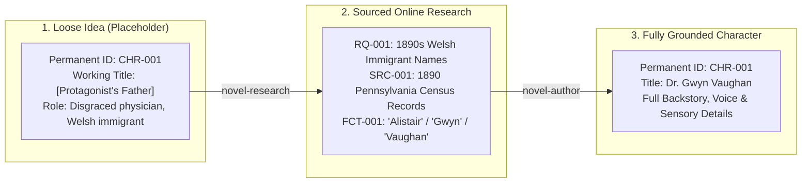

# Starting from Scratch: From a Rough Idea to a Spec-Driven Novel

Most novels do not begin as fully formed outlines with complete cast lists and verified historical dates. They begin as messy, embryonic fragments: a striking image, a dynamic between two unnamed figures, a "what if" premise, or an evocative historical moment whose details you have not yet researched.

In traditional writing, jumping directly into prose with unresearched placeholders usually leads to two failure modes:
1. **Premature Naming & Detail Lock-in**: You invent character names, street addresses, or technical contraptions off the top of your head. Later, your historical or scientific research reveals that the name is anachronistic for their generation and ethnicity, the street didn't exist in 1892, or the technology violates period physics. Fixing this across 40,000 words of drafted prose is agonizing.
2. **Analysis Paralysis**: You get stuck in endless research rabbit holes before typing a single scene beat, losing the emotional spark that inspired the story.

**SpecNovelist solves this through Spec-as-Source and Stable Identity Decoupling.**

This guide walks you through starting a novel project from a loosely organized story idea filled with placeholders, using research questions to systematically crystallize provisional elements into authentic canon.

---

## The Core Concept: Stable Identity Decoupling

In SpecNovelist, **an entity's identity is defined by its permanent alphanumeric ID, NOT its temporary name.**



- In traditional writing: Renaming "John" to "Alistair" requires searching and replacing across draft chapters, frequently missing pronouns, possessives, and dialogue tags.
- In SpecNovelist: The entity is `[[CHR-001]]` everywhere in the outline and knowledge base. Whether titled `[Protagonist's Father]` on Day 1 or `Dr. Gwyn Vaughan` on Day 5, **all cross-references remain 100% valid**. Moving from placeholder to canon requires changing only the definition in `kb/characters/CHR-001.md`.

---

## Step-by-Step Workflow

### Step 1: Capture the Raw Seed in `story/synopsis.md`

Start with what you know and explicitly mark what you don't. Use **bracketed functional descriptors** for any element that requires research before naming:

```markdown
---
title: The Iron Threshold
genre: Historical Literary Mystery
target_words: 85000
status: rough-concept
---
# Synopsis

In [summer 1892], in an industrial steel town near [Pittsburgh], [Protagonist - Eldest Daughter], a 22-year-old telegrapher, discovers that her father—[Father - Disgraced Physician], an immigrant who fled [industrial region in Wales] after a mine disaster—is secretly treating wounded union organizers in an abandoned brick kiln.

When a company detective is poisoned with an uncommon chemical alkaloid, [Father] is arrested. [Protagonist] must navigate the tense labor standoff, company spies, and her father's hidden past to identify the real poisoner before martial law is declared.

### Known Story Elements
- Protagonist: Young female telegraph operator. Quick-witted, observant, understands Morse cadence.
- Father: Former physician, alcoholic, haunted by guilt, highly principled under stress.
- Setting: A smoke-choked Monongahela River mill town during a labor lockout.
- Central Conflict: Whodunit murder mystery intertwined with historical labor warfare.

### Placeholders Requiring Research
- Protagonist & Father names: Need authentic Welsh-immigrant names matching generation (born ~1845 and ~1870).
- Specific chemical poison: Must be a period-accurate industrial or medical compound available in 1892.
- Mill town layout: Need historical geography of mill gates, river barges, and worker tenements.
```

> [!TIP]
> **Placeholder Formatting Rule**: Use clear, descriptive bracketed terms like `[Father - Disgraced Physician]` or `[Rival Ship Captain]`. Do not use generic temporary names like "Bob" or "John"—they tend to accidentally stick and fool your brain into treating them as finished choices.

---

### Step 2: Initialize the Project and Bootstrap Agents

Run the SpecNovelist bootstrapper in your project directory:

```bash
# 1. Initialize the SpecNovelist folder structure
python scripts/specnovel.py init

# 2. Check the initial catalog status
python scripts/specnovel.py status
```

This creates the scaffolding (`story/`, `kb/`, `outline/`, `abridged/`, `manuscript/`). Save your seed synopsis into `story/synopsis.md`.

---

### Step 3: Run the Guided Discovery Interview (`novel-init`)

Invoke the **`novel-init`** skill with your AI assistant:

> *"Run novel-init. I have placed a rough synopsis with placeholders in story/synopsis.md. Let's do the discovery interview, but keep character names and specific historical locations as placeholders until we research period demographics."*

The agent will lead the structured interview:
1. **Reflect**: The agent summarizes the core narrative architecture, explicitly noting your placeholders.
2. **Batch Questions**: The agent asks about structural pacing, themes, narrator stance, and research rigor, **without forcing you to invent names or unresearched facts**.
3. **Populate `story/brief.md`**: Records your creative decisions, logging open questions for placeholder elements.
4. **Seed the Knowledge Base**:
   - `kb/characters/CHR-001.md` is created with permanent ID `CHR-001` and title `CHR-001: [Protagonist - Eldest Daughter]`.
   - `kb/characters/CHR-002.md` is created as `CHR-002: [Father - Disgraced Physician]`.
   - `kb/places/PLC-001.md` is created as `PLC-001: [Monongahela River Mill Town]`.
5. **Automate Research Backlog Generation**: `novel-init` automatically invokes the placeholder extraction pipeline to turn all seed placeholders into cataloged research questions (`RQ`) without any manual typing.

---

### Step 4: Automatically Convert Placeholders into Research Questions (`RQ`)

You do not need to manually write research questions for each unknown detail. SpecNovelist provides an **automated placeholder extraction engine** built directly into `specnovel.py`.

#### 1. Scan Untracked Placeholders
Run `specnovel.py placeholders` to inspect all provisional elements detected across `story/`, `kb/`, and `outline/`:

```bash
python scripts/specnovel.py placeholders
```

Example output:
```text
# Placeholders detected in project specifications:

  [Protagonist - Eldest Daughter]
    Locations: story/synopsis.md:57, kb/characters/CHR-001.md:1 (in [[CHR-001]])
    Status:    UNTRACKED

  [Father - Disgraced Physician]
    Locations: story/synopsis.md:57, kb/characters/CHR-002.md:1 (in [[CHR-002]])
    Status:    UNTRACKED

  [summer 1892]
    Locations: story/synopsis.md:57
    Status:    UNTRACKED

  [Pittsburgh]
    Locations: story/synopsis.md:57
    Status:    UNTRACKED

  Period poison: Need uncommon medical alkaloid available in 1892.
    Locations: story/synopsis.md:69
    Status:    UNTRACKED

5 untracked placeholder(s) found out of 5 total.
Run 'python scripts/specnovel.py placeholders --create-rq' to automatically generate research questions in kb/research/questions.md.
```

The engine automatically:
- Scans bracketed descriptors (`[...]`), angle brackets (`<...>`), `TODO`/`TBD` markers, and list items under placeholder sections.
- Deduplicates occurrences across files (e.g., identifying that `[Protagonist - Eldest Daughter]` in `story/synopsis.md` and `kb/characters/CHR-001.md` refers to the same underlying entity).
- Associates placeholders with enclosing entity IDs (`[[CHR-001]]`).

#### 2. Generate the Research Backlog Automatically
Run `placeholders --create-rq`:

```bash
python scripts/specnovel.py placeholders --create-rq
```

Example output:
```text
Generated 5 research question(s) in kb/research/questions.md:

  + RQ-001: Research for [Protagonist - Eldest Daughter] (high priority, needed for [[CHR-001]])
  + RQ-002: Research for [Father - Disgraced Physician] (high priority, needed for [[CHR-002]])
  + RQ-003: Research for [summer 1892] (high priority, needed for story/synopsis.md)
  + RQ-004: Research for [Pittsburgh] (high priority, needed for story/synopsis.md)
  + RQ-005: Research for Period poison (high priority, needed for story/synopsis.md)

Updated kb/research/questions.md.
Run 'python scripts/specnovel.py check' to verify catalog integrity.
```

The engine writes complete, structured entries directly into `kb/research/questions.md`:

```markdown
# Research Questions

## RQ-001: Research for [Protagonist - Eldest Daughter]
- **Status:** open
- **Priority:** high
- **Needed for:** [[CHR-001]]
- **Question:** What are authentic period, demographic, and character details (including name, ethnicity, generation) for 'Protagonist - Eldest Daughter'?
- **Context:** In [summer 1892], in an industrial steel town near [Pittsburgh], [Protagonist - Eldest Daughter], a 22-year-old telegrapher...
- **Answer:**
- **Notes:** Automatically generated from placeholder in story/synopsis.md:57

## RQ-002: Research for [Father - Disgraced Physician]
- **Status:** open
- **Priority:** high
- **Needed for:** [[CHR-002]]
- **Question:** What are authentic period, demographic, and character details (including name, ethnicity, generation) for 'Father - Disgraced Physician'?
- **Context:** discovers that her father—[Father - Disgraced Physician], an immigrant who fled...
- **Answer:**
- **Notes:** Automatically generated from placeholder in story/synopsis.md:57
```

#### 3. Idempotent & Non-Duplicating
If you run `specnovel.py placeholders` again, it reports that all items are now `TRACKED by [[RQ-xxx]]`:

```text
# Placeholders detected in project specifications:

  [Protagonist - Eldest Daughter]
    Locations: story/synopsis.md:57, kb/characters/CHR-001.md:1 (in [[CHR-001]])
    Status:    TRACKED by [[RQ-001]]
...
All 5 detected placeholder(s) are tracked by research questions.
```

If you add a new placeholder later (e.g. `[River barge captain]` in a scene outline), running `specnovel.py placeholders --create-rq` will allocate only the new `RQ-006` without altering or duplicating existing questions!

---

### Step 5: Execute Authoritative Online Research (`novel-research`)

Now prompt your agent to resolve the research questions using the **`novel-research`** skill:

> *"Use novel-research to answer RQ-001 regarding 1890s Welsh immigrant names in Pennsylvania. Find primary census data or university immigration monographs."*

The agent searches authoritative historical records, reads the actual sources, and catalogs the findings:

1. **Source Record (`kb/sources/SRC-001-welsh-census.md`)**:
   ```markdown
   # SRC-001: 1890 Allegheny County Industrial Demographics & Census
   - **Type:** primary
   - **URL:** https://archive.org/details/...
   - **Accessed:** 2026-10-24
   - **Citation:** US Census Bureau, Special Census of Immigrant Labor, Western District of Pennsylvania (1890).
   - **Reliability:** authoritative primary record
   ```

2. **Fact Record (`kb/facts/FCT-001-welsh-naming.md`)**:
   ```markdown
   # FCT-001: Welsh immigrant naming conventions in Allegheny County (1880-1895)
   - **Statement:** First-generation Welsh immigrant men in industrial western Pennsylvania overwhelmingly bore traditional patronymic surnames (Vaughan, Llewellyn, Griffiths, Evans) and biblical/traditional given names (Gwyn, Alistair, Rhys). Daughters born in the US during the 1870s frequently received Anglicized Welsh names (Elen, Megan, Bronwen) or popular contemporary American names (Clara, Cora).
   - **Sources:** [[SRC-001]], pp. 142-145
   - **Confidence:** high
   - **Story use:** Resolves names for [[CHR-001]] and [[CHR-002]].
   ```

3. **Close the Research Question**:
   Update `RQ-001` in `kb/research/questions.md` with `- **Status:** answered` and link to `[[FCT-001]]`.

---

### Step 6: Promote Researched Facts to Character & Setting Canon (`novel-author`)

With factual research in hand, summon **`novel-author`** to update the provisional character and place entries:

> *"Use novel-author to update CHR-001 and CHR-002 based on FCT-001. Name the protagonist Elen Vaughan and her father Dr. Gwyn Vaughan."*

The agent updates `kb/characters/CHR-001.md`:

```markdown
# CHR-001: Elen Vaughan
- **Role:** Protagonist; POV character
- **Aliases:** "Lena" (family); "Miss Vaughan" (at the telegraph office)
- **Born / age:** 1870, Homestead, PA; 22 at story start ([[TML-001]])
- **Ethnicity / culture:** Second-generation Welsh-American; understands spoken Welsh but responds in English
- **Voice:** Direct, speaks in rhythmic, clipped phrasing (influenced by Morse rhythms)
- **External Want:** Clear her father of murder charges without instigating military slaughter
- **Internal Need:** Overcome her shame of her father's fall and claim her own authority
- **Relationships:**
  - [[CHR-002]]: father; protective resentment
- **Continuity:** Slight ink stain on right index finger; gray-green eyes; scarred left palm from telegraph key burn
```

Notice what happened:
- The ID **`CHR-001`** never changed.
- Any existing scene, outline beat, or note that linked `[[CHR-001]]` automatically resolves to **Elen Vaughan**.
- You can now use wiki-link aliases freely: `[[CHR-001|Elen]]` or `[[CHR-001|Lena]]`.

Verify catalog integrity:
```bash
python scripts/specnovel.py check
```

---

### Step 7: Build the Outline Around the Researched Canon (`novel-outline`)

Once major placeholders are grounded in researched facts, use **`novel-outline`** to construct the novel's skeleton in reading order (`outline/outline.md`):

```markdown
#### SCN-001: The Night Shift Wire
- **Prerequisites:** None
- **When:** 1892-06-28, 23:15 ([[TML-002]])
- **Where:** [[PLC-002]] (Western Union depot at the railroad crossing)
- **POV:** [[CHR-001]] (Elen Vaughan)
- **Cast:** [[CHR-001]], [[CHR-004]] (Night dispatcher)
- **Plot:** introduces [[PLT-001]] (company alert wire intercepted)
- **Facts:** [[FCT-003]] (1892 telegraph cipher protocols)
- **Goal / conflict / outcome:** Elen wants to finish her shift; she intercepts a private Pinkerton dispatch warning of armed barges; she copies it down against regulations.
- **Beats:**
  1. The rhythmic clack of the sounder cutting through the river mist.
  2. Elen decodes the encrypted dispatch from Pittsburgh.
  3. The dispatcher enters unexpectedly; Elen slips the paper into her stocking.
- **Key dialogue:**
  - Dispatcher: "Quiet night, Miss Vaughan?"
  - Elen: "Dead quiet, Mr. Hallowell. Only the river."
- **Change:** Elen shifts from routine worker to possessing illegal knowledge of an impending attack.
- **Target words:** 2200
```

Run automated DAG and reading order verification:
```bash
python scripts/specnovel.py dag
python scripts/specnovel.py check
```

---

## When Must Placeholders Be Resolved?

SpecNovelist allows progressive disclosure across the pipeline stages:

| Pipeline Layer | Placeholders Allowed? | Permissible Scope |
|---|---|---|
| **`story/synopsis.md`** | **YES** (Unlimited) | Any unknown character, setting, technology, or date can be bracketed `[...]`. |
| **`story/brief.md`** | **YES** (Logged) | Unresolved items are logged under `## Open questions` with linked `[[RQ-...]]` items. |
| **`kb/` (Knowledge Base)** | **YES** (Provisional) | Entries can have functional titles (`CHR-001: [Protagonist Father]`), provided they have an ID and a linked `[[RQ-...]]`. |
| **`outline/`** | **LIMITED** | Macro turning points, scene beats, and causality DAG prerequisites must be locked in. Minor secondary characters or specific room names may remain provisional if flagged with `- **Provisional:** awaiting [[RQ-xxx]]`. |
| **`abridged/`** | **NO for Major Elements** | Major cast names, core dialogue, and scene locations must be finalized. Minor incidental background labels (e.g. `an unnamed steward`) are permitted. |
| **`manuscript/`** | **STRICTLY ZERO** | Final prose must be 100% immersive literary prose with zero bracketed placeholders (`[...]`) and zero raw `[[ID]]` tags. `specnovel.py check` warns if raw tags leak into the manuscript. |

---

## Practical Tips for Starting from Scratch

1. **Don't Let Unknowns Block Structural Brainstorming**:
   If you don't know the exact 1892 train schedule, write:
   `- **When:** 1892-06-28, late evening (provisional, awaiting [[RQ-004]])`
   Keep outlining the causal chain of events. File the `RQ` and let `novel-research` resolve the exact minutes later.

2. **Use `specnovel.py trace` to See What a Placeholder Touches**:
   Before updating a placeholder character or place, run:
   ```bash
   python scripts/specnovel.py trace CHR-001
   ```
   This displays every scene in reading order where `CHR-001` appears, showing you the exact ripple effect of your research discoveries.

3. **Promote Discovered Nuance into `story/style.md`**:
   When your research uncovers authentic period speech patterns (e.g. 19th-century telegraphers using Morse metaphors in daily speech), don't keep it as isolated trivia in `kb/`. Promote it to `story/style.md` under `## 13. Per-POV variations` so the `novel-write` engine naturally infuses it into every sentence of their viewpoint.

4. **Iterate with Baselines**:
   Once all embryonic placeholders in your brief and outline are resolved:
   ```bash
   python scripts/specnovel.py index
   python scripts/specnovel.py accept --stage plan -m "Baseline: Resolve all demographic placeholders for cast and setting"
   ```
   You now have an authoritative, version-controlled story bible ready for abridged drafting and prose synthesis!
